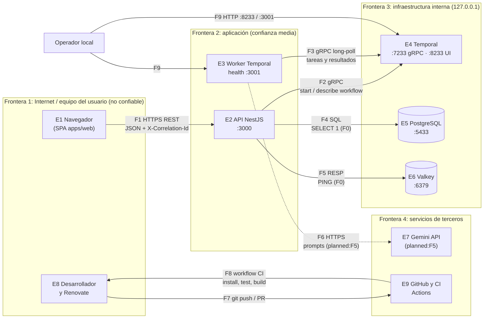

# Modelo de amenazas — CognitiveDAG (v1, F0)

> Estado: v1, alcance de la fase F0 (esqueleto ejecutable). Fecha: 2026-10-28.
> Método: diagrama de flujo de datos con límites de confianza y análisis STRIDE por elemento y
> por flujo. Se revisa en cada fase y se cierra en F8 (`docs/PLAN.md` §10).
> Referencias: `docs/PLAN.md` §6 (seguridad), constitución, principio I.

## 1. Alcance y supuestos

- F0 se ejecuta solo en local. No hay autenticación, tenants, LLM ni despliegue público
  (`specs/001-foundations-skeleton/spec.md`, "Assumptions").
- Los elementos que aún no existen (Gemini, autenticación, RLS) se modelan para que su
  introducción no cambie el diagrama; sus amenazas quedan como `planned:<fase>`.
- Los activos a proteger en F0 son: la integridad de las ejecuciones de workflow, la ausencia de
  secretos en el repositorio y la cadena de entrega (CI y dependencias). Los datos de usuario
  (F1) y los prompts y salidas del LLM (F5) aparecen cuando existan.

### Estados

| Estado        | Significado                                                                       |
| ------------- | --------------------------------------------------------------------------------- |
| `mitigated`   | Hay un control en el código o la configuración, citado, y una prueba o evidencia. |
| `accepted`    | Riesgo conocido sin control en esta fase, con la razón por la que es aceptable.   |
| `planned:<F>` | Se mitigará en la fase `<F>`; no existe aún en el código.                         |

## 2. Diagrama de flujo de datos

Elementos: E1 navegador, E2 API, E3 worker, E4 Temporal, E5 PostgreSQL, E6 Valkey, E7 Gemini,
E8 desarrollador y Renovate, E9 GitHub y CI. Flujos: F1 a F9 según el diagrama. Los puertos de
E4, E5 y E6 y la salud del worker escuchan solo en `127.0.0.1` (`compose.yaml`,
`apps/worker/src/health/server.ts`).

## 3. Análisis STRIDE por elemento

S = Spoofing, T = Tampering, R = Repudiation, I = Information disclosure, D = Denial of service,
E = Elevation of privilege.

### E1 Navegador (SPA `apps/web`)

| Cat. | Amenaza                                          | Estado       | Evidencia o razón                                                                                                                                      |
| ---- | ------------------------------------------------ | ------------ | ------------------------------------------------------------------------------------------------------------------------------------------------------ |
| S    | Un tercero se hace pasar por un usuario legítimo | `planned:F1` | No hay identidad en F0; F1 agrega login, refresh rotado y cookie `httpOnly`                                                                            |
| T    | Un script inyectado altera la UI (XSS)           | `mitigated`  | React escapa por defecto; la web renderiza texto, sin `dangerouslySetInnerHTML` (`apps/web/src`); CSP de Helmet en el API (`security-headers.test.ts`) |
| R    | El usuario niega una acción                      | `planned:F1` | Log de auditoría por tenant en F1                                                                                                                      |
| I    | Secretos en el bundle de la web                  | `mitigated`  | Solo `VITE_API_URL` se expone; gitleaks en CI (`.github/workflows/ci.yml`, job `security`)                                                             |
| D    | Un cliente satura la interfaz                    | `accepted`   | Aplicación cliente; el límite relevante está en el API (E2)                                                                                            |
| E    | Un usuario accede a funciones de otro rol        | `planned:F1` | Roles y guards en F1; el flag `ping-enabled` nunca se usa como control de seguridad (constitución, I)                                                  |

### E2 API NestJS

| Cat. | Amenaza                                                      | Estado       | Evidencia o razón                                                                                                                                                 |
| ---- | ------------------------------------------------------------ | ------------ | ----------------------------------------------------------------------------------------------------------------------------------------------------------------- |
| S    | Suplantación de usuario o de servicio                        | `planned:F1` | Sin autenticación en F0; el sistema no se despliega públicamente hasta F1                                                                                         |
| S    | `X-Correlation-Id` falsificado para contaminar logs o trazas | `mitigated`  | Solo se acepta un UUID válido; si no, se genera uno (`packages/contracts/src/correlation.ts`; `correlation.test.ts`)                                              |
| T    | Entrada malformada o con campos extra                        | `mitigated`  | Validación Zod en el borde con `nestjs-zod`, esquemas `.strict` (`pings.contract.test.ts`; `problem-details.test.ts`: 422)                                        |
| T    | Cuerpo sobredimensionado                                     | `mitigated`  | Límite `BODY_LIMIT` en `JsonBodyMiddleware`; 413 `PAYLOAD_TOO_LARGE` (`problem-details.test.ts`)                                                                  |
| T    | Configuración inválida o ausente en el arranque              | `mitigated`  | Esquema Zod; el proceso termina con código 1 y nombra solo las variables (`env.schema.test.ts`, `main.ts`)                                                        |
| R    | No se puede reconstruir qué pasó con una petición            | `mitigated`  | Logs JSON con `correlationId` en API y worker (`correlation.propagation.test.ts`); auditoría por tenant en F1                                                     |
| I    | Stack traces o detalles internos en errores                  | `mitigated`  | `ProblemDetailsFilter` genera `detail` genérico en 5xx (`problem-details.test.ts`: "500 without stack trace"; 503 sin dirección)                                  |
| I    | Secretos o credenciales en logs                              | `mitigated`  | Redacción de `authorization`, `cookie`, `password`, `token`, `secret`, `apiKey`, `credentials` (`packages/logger`; `redaction.test.ts`)                           |
| I    | Origen no autorizado lee respuestas (CORS)                   | `mitigated`  | CORS restringido a `WEB_ORIGIN` (`app.factory.ts`; `security-headers.test.ts`)                                                                                    |
| I    | Cabeceras de seguridad ausentes                              | `mitigated`  | `helmet()` (`app.factory.ts`; `security-headers.test.ts`)                                                                                                         |
| D    | Ráfagas de peticiones                                        | `planned:F1` | Rate limiting por tenant y usuario en F1/F4; en F0 el servicio solo escucha en local                                                                              |
| D    | Temporal caído bloquea peticiones                            | `mitigated`  | Plazo de 5 s y reintentos acotados; 503 `SERVICE_UNAVAILABLE` ([ADR-0022](adr/0022-plazo-y-reintentos-grpc-en-llamadas-a-temporal.md); `problem-details.test.ts`) |
| E    | Acceso a datos de otro tenant                                | `planned:F1` | Guards, `tenant_id` y RLS en PostgreSQL (constitución, I; [ADR-0007](adr/0007-multiusuario-y-multi-tenant.md))                                                    |
| E    | Operación sensible tras un flag apagado                      | `mitigated`  | Con `ping-enabled` apagado, 404 `FEATURE_NOT_AVAILABLE`; un flag desconocido se evalúa como apagado (`flags.test.ts`, `flags.service.ts`)                         |

### E3 Worker Temporal

| Cat. | Amenaza                                                   | Estado       | Evidencia o razón                                                                                         |
| ---- | --------------------------------------------------------- | ------------ | --------------------------------------------------------------------------------------------------------- |
| S    | Un proceso falso se registra como worker en la task queue | `accepted`   | El servidor de desarrollo de Temporal no autentica y solo escucha en `127.0.0.1`; mTLS y namespaces en F9 |
| T    | Resultado duplicado o alterado tras reinicios             | `mitigated`  | Una sola ejecución por `workflowId`; el resultado es único tras `SIGKILL` (`ping.chaos.test.ts`)          |
| T    | Código de workflow no determinista                        | `mitigated`  | Prueba de replay del historial guardado (`ping.replay.test.ts`)                                           |
| R    | Una actividad se ejecuta sin rastro                       | `mitigated`  | Logs del worker con `correlationId`; historial inmutable en Temporal (`correlation.propagation.test.ts`)  |
| I    | Identificador de máquina o secretos en los logs           | `mitigated`  | Identidad opaca por proceso (`worker-id.test.ts`); misma redacción que el API                             |
| D    | Fallo de una actividad agota recursos                     | `mitigated`  | `startToCloseTimeout` 5 s y máximo 3 intentos (`ping.workflow.ts`; `ping.workflow.test.ts`)               |
| D    | Caída del worker pierde trabajo                           | `mitigated`  | El estado es durable; otro worker retoma la ejecución (`ping.chaos.test.ts`)                              |
| E    | Una actividad ejecuta acciones fuera del grafo publicado  | `planned:F3` | En F0 solo existe `pong`; el intérprete de DAG (F3) usa un catálogo cerrado de nodos                      |

### E4 Temporal (servidor de desarrollo)

| Cat. | Amenaza                                            | Estado      | Evidencia o razón                                                                                       |
| ---- | -------------------------------------------------- | ----------- | ------------------------------------------------------------------------------------------------------- |
| S    | Cliente no autenticado inicia o consulta workflows | `accepted`  | Solo `127.0.0.1` (`compose.yaml`); en F9 la UI queda tras túnel SSH y gRPC con mTLS (`docs/PLAN.md` §9) |
| T    | Alterar historiales o el archivo SQLite            | `accepted`  | Volumen local de desarrollo; producción usa PostgreSQL con credenciales propias (F9)                    |
| R    | Operaciones administrativas sin registro           | `accepted`  | Solo desarrollo; el historial de workflows es inmutable                                                 |
| I    | La UI de Temporal expone payloads                  | `mitigated` | UI en `127.0.0.1:8233`, sin exposición pública; los payloads de F0 no contienen datos personales        |
| D    | Saturar el servidor de desarrollo                  | `accepted`  | Solo local, un usuario                                                                                  |
| E    | Acceso administrativo a todos los namespaces       | `accepted`  | Un solo namespace `default` en local; separación por entorno en F9                                      |

### E5 PostgreSQL

| Cat. | Amenaza                                         | Estado       | Evidencia o razón                                                                                           |
| ---- | ----------------------------------------------- | ------------ | ----------------------------------------------------------------------------------------------------------- |
| S    | Conexión con credenciales débiles               | `accepted`   | Contraseña `local_dev_only` solo en desarrollo, puerto en `127.0.0.1`; producción con secretos propios (F9) |
| T    | Inyección SQL                                   | `mitigated`  | F0 solo ejecuta `SELECT 1` (`dependency.indicators.ts`); consultas parametrizadas desde F1 (A05)            |
| R    | Cambios de datos sin auditoría                  | `planned:F1` | Tabla de auditoría por tenant                                                                               |
| I    | Datos de un tenant visibles a otro              | `planned:F1` | RLS como segunda capa ([ADR-0007](adr/0007-multiusuario-y-multi-tenant.md))                                 |
| D    | Agotamiento de conexiones                       | `planned:F1` | Pool con límites al introducir el acceso a datos; en F0 una conexión por chequeo                            |
| E    | Usuario de aplicación con privilegios excesivos | `planned:F1` | Rol de aplicación sin `BYPASSRLS` ni propiedad de las tablas                                                |

### E6 Valkey

| Cat. | Amenaza                                               | Estado       | Evidencia o razón                                                           |
| ---- | ----------------------------------------------------- | ------------ | --------------------------------------------------------------------------- |
| S    | Cliente no autenticado                                | `accepted`   | Sin contraseña en local, solo `127.0.0.1`; `requirepass`/ACL y TLS en F4/F9 |
| T    | Alterar contadores de rate limit o estado de breakers | `planned:F4` | En F0 solo se usa `PING`; el estado compartido llega en F4                  |
| R    | Operaciones sin rastro                                | `accepted`   | Sin datos de negocio en F0                                                  |
| I    | Datos sensibles en claves o valores                   | `planned:F4` | Claves con prefijo de tenant y sin datos personales en F4                   |
| D    | Memoria agotada                                       | `accepted`   | Sin datos en F0; `maxmemory` y política de expulsión en F4/F9               |
| E    | Comandos administrativos desde la aplicación          | `planned:F4` | ACL con comandos mínimos al introducir el uso real                          |

### E7 Gemini API (planned:F5)

| Cat. | Amenaza                                       | Estado       | Evidencia o razón                                                                                          |
| ---- | --------------------------------------------- | ------------ | ---------------------------------------------------------------------------------------------------------- |
| S    | Clave de API robada o expuesta                | `planned:F5` | Clave solo en variables de entorno, nunca en el repo (gitleaks), redactada en logs                         |
| T    | Prompt injection altera la salida (LLM01)     | `planned:F5` | Contenido externo delimitado como datos; salida solo estructurada y validada con Zod                       |
| R    | Uso del modelo sin atribución                 | `planned:F5` | Telemetría por tenant y ejecución                                                                          |
| I    | Datos sensibles enviados al proveedor (LLM02) | `planned:F5` | Minimizar datos, redactar PII, revisar la retención del plan de Gemini                                     |
| D    | Consumo ilimitado y costo (LLM06)             | `planned:F5` | Presupuesto por llamada, ejecución, tenant y día; límite de tamaño de entrada                              |
| E    | Salida del LLM decide acciones (LLM03, LLM10) | `planned:F5` | El LLM actúa como compilador ([ADR-0002](adr/0002-llm-como-compilador-de-dag.md)); nunca ejecuta su salida |

### E8 Desarrollador y Renovate

| Cat. | Amenaza                                               | Estado      | Evidencia o razón                                                                                                                      |
| ---- | ----------------------------------------------------- | ----------- | -------------------------------------------------------------------------------------------------------------------------------------- |
| S    | Commits con identidad falsa                           | `accepted`  | Proyecto de un autor; la protección de `main` exige PR. Commits firmados se evaluarán si se suman colaboradores                        |
| T    | Dependencia comprometida entra con una actualización  | `mitigated` | Versiones exactas, `minimumReleaseAge` de 3 días, scripts denegados ([ADR-0020](adr/0020-politica-de-cadena-de-suministro-de-pnpm.md)) |
| R    | Cambios sin trazabilidad                              | `mitigated` | Conventional Commits verificados por commitlint; PR obligatoria en `main`                                                              |
| I    | Secretos o datos personales en el repositorio público | `mitigated` | gitleaks con historial completo bloquea el merge (`ci-evidence.md`, control `secret`); `.env` ignorado por git                         |
| D    | No aplica en el entorno del desarrollador             | `accepted`  | Sin servicio expuesto                                                                                                                  |
| E    | Hooks locales omitidos con `--no-verify`              | `mitigated` | Los mismos controles corren en CI y bloquean el merge (`ci-evidence.md`)                                                               |

### E9 GitHub y CI

| Cat. | Amenaza                                                 | Estado      | Evidencia o razón                                                                                   |
| ---- | ------------------------------------------------------- | ----------- | --------------------------------------------------------------------------------------------------- |
| S    | Acción de terceros sustituida por una versión maliciosa | `mitigated` | Acciones fijadas por SHA (`.github/workflows/ci.yml`); Renovate actualiza los SHA                   |
| T    | Merge de código que no pasa los controles               | `mitigated` | Seis checks requeridos en la protección de `main`, verificados con PR bloqueadas (`ci-evidence.md`) |
| R    | Ejecuciones de CI sin registro                          | `mitigated` | Historial de Actions y de PR de GitHub                                                              |
| I    | Secretos del repositorio expuestos a PR externas        | `mitigated` | CI sin secretos de repositorio; permisos `contents: read`                                           |
| D    | Consumo de minutos o runners                            | `accepted`  | Repositorio público: minutos gratuitos; `timeout-minutes` por job y `concurrency` con cancelación   |
| E    | Token de CI con permisos excesivos                      | `mitigated` | `permissions: contents: read` a nivel de workflow                                                   |

## 4. Análisis STRIDE por flujo de datos

| Flujo                                     | Cat.        | Amenaza                                            | Estado       | Evidencia o razón                                                                                                         |
| ----------------------------------------- | ----------- | -------------------------------------------------- | ------------ | ------------------------------------------------------------------------------------------------------------------------- |
| F1 Navegador → API                        | S           | Petición sin identidad                             | `planned:F1` | Autenticación en F1                                                                                                       |
| F1                                        | T           | Manipulación de la petición en tránsito            | `planned:F9` | En local es HTTP sobre loopback; TLS con Caddy en el despliegue                                                           |
| F1                                        | R           | Petición sin identificador de correlación          | `mitigated`  | El API siempre devuelve `X-Correlation-Id` (`correlation.test.ts`)                                                        |
| F1                                        | I           | Respuesta de error revela internos                 | `mitigated`  | `problem-details.test.ts`                                                                                                 |
| F1                                        | D           | Cuerpos grandes o ráfagas                          | `mitigated`  | Cuerpos: 413 por `BODY_LIMIT`. Ráfagas: `planned:F1`                                                                      |
| F1                                        | E           | Elevación vía parámetros (IDs ajenos)              | `planned:F1` | Autorización por recurso; el `pingId` solo admite el formato `ping-<uuid>` (`contracts.test.ts`)                          |
| F2 API → Temporal                         | S           | Servidor Temporal suplantado                       | `accepted`   | Loopback en local; mTLS en F9                                                                                             |
| F2                                        | T           | Inicio duplicado de una ejecución                  | `mitigated`  | `workflowId = ping-<Idempotency-Key>` con `REJECT_DUPLICATE` (`pings.idempotency.test.ts`)                                |
| F2                                        | R           | Ejecución no asociable a la petición               | `mitigated`  | Search attribute `CorrelationId` (`correlation.propagation.test.ts`)                                                      |
| F2                                        | I           | Datos sensibles en la entrada del workflow         | `mitigated`  | La entrada solo contiene `message` y `correlationId`; sin datos personales en F0                                          |
| F2                                        | D           | Llamadas sin límite de tiempo                      | `mitigated`  | [ADR-0022](adr/0022-plazo-y-reintentos-grpc-en-llamadas-a-temporal.md)                                                    |
| F2                                        | E           | Iniciar workflows no autorizados                   | `planned:F1` | Autorización por tenant antes de iniciar; el flag no sustituye la autorización                                            |
| F3 Worker ↔ Temporal                      | S           | Worker no autorizado toma tareas                   | `accepted`   | Loopback; mTLS y namespaces en F9                                                                                         |
| F3                                        | T           | Tareas ejecutadas dos veces                        | `mitigated`  | Una sola ejecución observable tras `SIGKILL` (`ping.chaos.test.ts`); actividades idempotentes por `runId:nodeId` desde F3 |
| F3                                        | R           | Resultado sin correlación                          | `mitigated`  | El ID viaja en la entrada de la actividad y en los logs del worker                                                        |
| F3                                        | I           | Payloads visibles en el servidor                   | `accepted`   | Sin datos personales en F0; cifrado de payloads con un data converter se evalúa en F5                                     |
| F3                                        | D           | Reintentos infinitos                               | `mitigated`  | Máximo 3 intentos y `workflowExecutionTimeout` (`ping.workflow.test.ts`)                                                  |
| F3                                        | E           | Actividad con más permisos que su nodo             | `planned:F3` | Task queues separadas por tipo de nodo (bulkheads, `docs/PLAN.md` §5.4)                                                   |
| F4 API → PostgreSQL                       | T           | Inyección SQL                                      | `mitigated`  | Solo `SELECT 1` en F0; consultas parametrizadas desde F1                                                                  |
| F4                                        | I           | Credenciales en `DATABASE_URL` en los logs         | `mitigated`  | El arranque nombra variables inválidas, nunca valores (`env.schema.test.ts`); la redacción cubre `password`               |
| F4                                        | D           | Base caída bloquea la API                          | `mitigated`  | Readiness informa `down` sin exponer el error (`health.test.ts`)                                                          |
| F4                                        | S/R/E       | Identidad del usuario ante la base, auditoría, RLS | `planned:F1` | `set_config` por transacción y RLS                                                                                        |
| F5 API → Valkey                           | T/I/D/E     | Manipulación o exposición de estado compartido     | `planned:F4` | En F0 solo `PING`; autenticación, prefijos por tenant y límites en F4                                                     |
| F5                                        | S           | Servidor Valkey suplantado                         | `accepted`   | Loopback en local                                                                                                         |
| F6 Worker → Gemini                        | S/T/R/I/D/E | Todas las categorías de LLM                        | `planned:F5` | Ver E7; TLS siempre, clave fuera del repo, salidas validadas                                                              |
| F7 Desarrollador → GitHub                 | S           | Push a `main` sin revisión                         | `mitigated`  | `main` protegido: solo PR con checks en verde (`ci-evidence.md`)                                                          |
| F7                                        | I           | Secretos en commits                                | `mitigated`  | gitleaks bloquea el merge; `.claude/` y `.env` ignorados                                                                  |
| F7                                        | T           | Historial reescrito                                | `mitigated`  | Protección de rama contra force-push en `main`                                                                            |
| F8 CI → entorno                           | T           | Dependencias vulnerables en la entrega             | `mitigated`  | `pnpm audit --audit-level high` bloquea (`ci-evidence.md`, control `audit`)                                               |
| F8                                        | T           | Imágenes con base alterada                         | `mitigated`  | Imágenes base fijadas por digest (`apps/*/Dockerfile`, `compose.yaml`)                                                    |
| F8                                        | I           | Secretos en logs de CI                             | `mitigated`  | gitleaks con `--redact`; CI sin secretos                                                                                  |
| F9 Operador → Temporal UI / worker health | S/E         | Acceso a la consola o a la salud                   | `accepted`   | Solo `127.0.0.1`; en producción, túnel SSH o autenticación delante                                                        |
| F9                                        | I           | La salud del worker expone detalles                | `mitigated`  | Solo `status` y estado `up/down`; 404 sin cuerpo para otras rutas (`apps/worker/test/integration/health.test.ts`)         |

## 5. Resumen y riesgos abiertos

- Cobertura: los 9 elementos y los 9 flujos del diagrama tienen amenazas analizadas (SC-008).
- Riesgos abiertos de mayor impacto, ambos fuera de alcance de F0 por decisión explícita
  ([ADR-0007](adr/0007-multiusuario-y-multi-tenant.md)): ausencia de autenticación y de aislamiento
  por tenant (`planned:F1`). Hasta entonces el sistema no se despliega públicamente.
- Riesgos aceptados que deben revisarse antes del despliegue (F9): Temporal, PostgreSQL y Valkey sin
  autenticación fuerte ni TLS; credenciales por defecto de desarrollo.
- Los controles `mitigated` que dependen de infraestructura (por ejemplo, la protección de `main`)
  se verificaron en F0 con PR descartables (`specs/001-foundations-skeleton/checklists/ci-evidence.md`).
