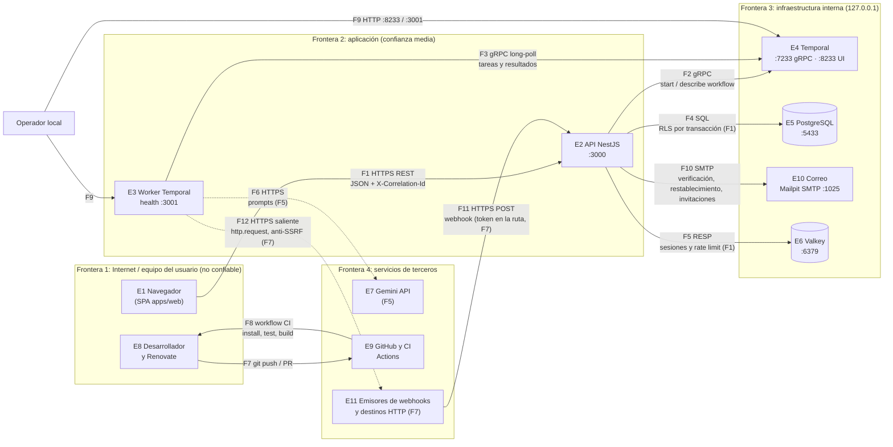

# Modelo de amenazas — CognitiveDAG (v3.0, cierre de F9)

> Estado: v3.0, cierre de F9 (2026-11-12). Reemplaza a la v2.0 (cierre de F8, 2026-11-09): el sistema ya corre en producción, así que Caddy, el registro de imágenes y las alertas son elementos reales (sección 3.7), nada queda diferido y lo que no se corrige pasa a `accepted` con dueño, razón y revisión. Los identificadores LLM siguen la edición 2025 de OWASP (ver [owasp-evidence.md](security/owasp-evidence.md)). `pnpm security:evidence` comprueba este documento y rechaza cualquier fila diferida ([ADR-0087](adr/0087-matriz-de-evidencia-owasp-comprobador-y-estados.md), [ADR-0099](adr/0099-cierre-de-f9-despliegue.md)).
> Método: diagrama de flujo de datos con límites de confianza y análisis STRIDE por elemento y
> por flujo. Se revisa en cada fase; F9 lo cierra con el despliegue real (`docs/PLAN.md` §10).
> Referencias: `docs/PLAN.md` §6 (seguridad), constitución, principio I.

## 1. Alcance y supuestos

- Desde F9 el sistema corre en producción: `https://cognitive.devama.cloud`, una VM Oracle Always Free (Ampere A1, 2 OCPU y 12 GB) con Docker Compose y Caddy como único punto de entrada. Es una **demo cerrada**: el registro está cerrado (404), las cuentas las crea el autor y solo se admiten datos de prueba. Hay autenticación, tenants con RLS, ejecución de DAG, nodos LLM, compilador, triggers y `http.request` (F1 a F7).
- Los elementos de F9 se modelan como reales en la sección 3.7: el borde Caddy (E12), el registro de imágenes OCIR y el despliegue (E13) y los registros con sus alertas (E14). El proveedor de correo es OCI Email Delivery (E10). No hay staging ni métricas de producción.
- Los activos a proteger son los datos de cada organización, las credenciales de conectores, la integridad de las ejecuciones, la ausencia de secretos en el repositorio y la cadena de entrega (CI y dependencias).

### Estados

| Estado           | Significado                                                                                              |
| ---------------- | -------------------------------------------------------------------------------------------------------- |
| `mitigated`      | Hay un control en el código o la configuración, citado, y una prueba o evidencia.                        |
| `accepted`       | Riesgo conocido sin control en esta fase: razón, **Dueño** y **Revisión** (fase) en la columna de razón. |
| `not-applicable` | El riesgo no existe en el diseño actual: razón y qué cambio lo activaría (solo en la matriz OWASP).      |

## 2. Diagrama de flujo de datos

Elementos: E1 navegador, E2 API, E3 worker, E4 Temporal, E5 PostgreSQL, E6 Valkey, E7 Gemini,
E8 desarrollador y Renovate, E9 GitHub y CI, E10 servidor de correo (Mailpit en desarrollo), E11
emisores de webhooks y destinos de `http.request` (F7; no son confiables). Flujos: F1 a F12 según el
diagrama. F1 agrega sesiones (cookie, PostgreSQL y Valkey) y correo. F11 y F12 los agrega F7: el
webhook entra por la API sin sesión y solo con el token de la ruta; el worker llama a destinos que
elige la organización, por lo que cada salto se valida (sección 3.6). Los puertos de
E4, E5 y E6 y la salud del worker escuchan solo en `127.0.0.1` (`compose.yaml`,
`apps/worker/src/health/server.ts`).

## 3. Análisis STRIDE por elemento

S = Spoofing, T = Tampering, R = Repudiation, I = Information disclosure, D = Denial of service,
E = Elevation of privilege.

### E1 Navegador (SPA `apps/web`)

| Cat. | Amenaza                                                                                                           | Estado      | Evidencia o razón                                                                                                                                                                                                                                                                                                                                                                                                                                                                                                                                                                                                  |
| ---- | ----------------------------------------------------------------------------------------------------------------- | ----------- | ------------------------------------------------------------------------------------------------------------------------------------------------------------------------------------------------------------------------------------------------------------------------------------------------------------------------------------------------------------------------------------------------------------------------------------------------------------------------------------------------------------------------------------------------------------------------------------------------------------------ |
| S    | Un tercero se hace pasar por un usuario legítimo                                                                  | `mitigated` | Sesión opaca en cookie `__Host-session` (`HttpOnly`, `Secure`, `SameSite=Lax`), CSRF sincronizador, rate limit progresivo y Argon2id ([ADR-0027](adr/0027-sesiones-opacas-y-csrf.md), [ADR-0025](adr/0025-argon2id-para-contrasenas.md); `login.test.ts`, `csrf.test.ts`, `rate-limit.test.ts`). Política de 8–25 caracteres: `accepted` en la sección 3.1                                                                                                                                                                                                                                                         |
| T    | Un script inyectado altera la UI (XSS)                                                                            | `mitigated` | React escapa por defecto; la web renderiza texto, sin `dangerouslySetInnerHTML` (`apps/web/src`); CSP de Helmet en el API (`security-headers.test.ts`)                                                                                                                                                                                                                                                                                                                                                                                                                                                             |
| R    | El usuario niega una acción                                                                                       | `mitigated` | Eventos de seguridad con `event`, `outcome`, `userId`, `organizationId`, `ip` y `correlationId` ([ADR-0038](adr/0038-eventos-de-seguridad-en-logs.md); `security-events.test.ts`). Sin tabla de auditoría: la retención se decide en F9                                                                                                                                                                                                                                                                                                                                                                            |
| I    | Secretos en el bundle de la web                                                                                   | `mitigated` | Solo `VITE_API_URL` se expone; gitleaks en CI (`.github/workflows/ci.yml`, job `security`)                                                                                                                                                                                                                                                                                                                                                                                                                                                                                                                         |
| D    | Un cliente satura la interfaz                                                                                     | `accepted`  | Aplicación cliente; el límite relevante está en el API (E2) Dueño: autor · Revisión: posterior a F9.                                                                                                                                                                                                                                                                                                                                                                                                                                                                                                               |
| E    | Un usuario accede a funciones de otro rol                                                                         | `mitigated` | `OrganizationGuard` valida membresía y rol en cada petición; 403 `FORBIDDEN` y 404 a no miembros (`organization.guard.test.ts`, `member-permissions.test.ts`, `cross-tenant.test.ts`); el flag nunca es control de seguridad                                                                                                                                                                                                                                                                                                                                                                                       |
| T    | La SPA se sirve sin `Content-Security-Policy` ni anti-clickjacking (ZAP 10038 y 10020, [zap.md](security/zap.md)) | `mitigated` | Caddy sirve la web con `Content-Security-Policy` (`default-src 'self'`, sin `unsafe-inline` en scripts, `frame-ancestors 'none'`), `X-Frame-Options: DENY`, `X-Content-Type-Options: nosniff`, `Permissions-Policy`, COEP, COOP y CORP (`deploy/caddy/site.caddy`; `scripts/test/unit/deploy-config.test.ts`). ZAP baseline contra la imagen de borde local: 10038, 10020, 10021, 10063 y 90004 desaparecen ([zap.md](security/zap.md)). Tras cada despliegue, `deploy/ops/check-headers.sh` las comprueba en el dominio real y revierte si faltan ([ADR-0098](adr/0098-verificacion-de-cabeceras-sin-staging.md)) |

### E2 API NestJS

| Cat. | Amenaza                                                      | Estado      | Evidencia o razón                                                                                                                                                                                                                        |
| ---- | ------------------------------------------------------------ | ----------- | ---------------------------------------------------------------------------------------------------------------------------------------------------------------------------------------------------------------------------------------- |
| S    | Suplantación de usuario o de servicio                        | `mitigated` | Todos los endpoints exigen sesión salvo salud, flags públicos y autenticación (`session.guard.ts`; `login.test.ts`). El registro público está cerrado en el borde: `POST /api/v1/auth/register` responde 404 (`deploy/caddy/site.caddy`) |
| S    | `X-Correlation-Id` falsificado para contaminar logs o trazas | `mitigated` | Solo se acepta un UUID válido; si no, se genera uno (`packages/contracts/src/correlation.ts`; `correlation.test.ts`)                                                                                                                     |
| T    | Entrada malformada o con campos extra                        | `mitigated` | Validación Zod en el borde con `nestjs-zod`, esquemas `.strict` (`pings.contract.test.ts`; `problem-details.test.ts`: 422)                                                                                                               |
| T    | Cuerpo sobredimensionado                                     | `mitigated` | Límite `BODY_LIMIT` en `JsonBodyMiddleware`; 413 `PAYLOAD_TOO_LARGE` (`problem-details.test.ts`)                                                                                                                                         |
| T    | Configuración inválida o ausente en el arranque              | `mitigated` | Esquema Zod; el proceso termina con código 1 y nombra solo las variables (`env.schema.test.ts`, `main.ts`)                                                                                                                               |
| R    | No se puede reconstruir qué pasó con una petición            | `mitigated` | Logs JSON con `correlationId` en API y worker (`correlation.propagation.test.ts`); eventos de seguridad de F1 (`security-events.test.ts`)                                                                                                |
| I    | Stack traces o detalles internos en errores                  | `mitigated` | `ProblemDetailsFilter` genera `detail` genérico en 5xx (`problem-details.test.ts`: "500 without stack trace"; 503 sin dirección)                                                                                                         |
| I    | Secretos o credenciales en logs                              | `mitigated` | Redacción de `authorization`, `cookie`, `password`, `token`, `secret`, `apiKey`, `credentials` (`packages/logger`; `redaction.test.ts`)                                                                                                  |
| I    | Origen no autorizado lee respuestas (CORS)                   | `mitigated` | CORS restringido a `WEB_ORIGIN` (`app.factory.ts`; `security-headers.test.ts`)                                                                                                                                                           |
| I    | Cabeceras de seguridad ausentes                              | `mitigated` | `helmet()` (`app.factory.ts`; `security-headers.test.ts`)                                                                                                                                                                                |
| D    | Ráfagas de peticiones                                        | `mitigated` | Rate limit por cuenta, IP y email en login, registro, reenvío, restablecimiento e invitaciones; falla cerrado si Valkey no responde ([ADR-0033](adr/0033-rate-limiter-flexible.md); `rate-limit.test.ts`). Límites por tenant: F4        |
| D    | Temporal caído bloquea peticiones                            | `mitigated` | Plazo de 5 s y reintentos acotados; 503 `SERVICE_UNAVAILABLE` ([ADR-0022](adr/0022-plazo-y-reintentos-grpc-en-llamadas-a-temporal.md); `problem-details.test.ts`)                                                                        |
| E    | Acceso a datos de otro tenant                                | `mitigated` | Guard de organización más RLS en PostgreSQL ([ADR-0028](adr/0028-organizacion-activa-en-la-ruta.md), [ADR-0029](adr/0029-rls-con-claves-de-contexto.md); `cross-tenant.test.ts`, `rls-defense.test.ts`, `rls.test.ts`)                   |
| E    | Operación sensible tras un flag apagado                      | `mitigated` | Desde F8 no hay flags de producto (ADR-0084); un flag desconocido se evalúa como apagado y el catálogo está vacío (`flags.test.ts`, `flags.service.ts`)                                                                                  |

### E3 Worker Temporal

| Cat. | Amenaza                                                   | Estado      | Evidencia o razón                                                                                                                                                                                                                   |
| ---- | --------------------------------------------------------- | ----------- | ----------------------------------------------------------------------------------------------------------------------------------------------------------------------------------------------------------------------------------- |
| S    | Un proceso falso se registra como worker en la task queue | `mitigated` | mTLS en el frontend de Temporal y namespace propio: un worker sin certificado de cliente no se conecta ([ADR-0091](adr/0091-temporal-en-produccion.md); `scripts/test/integration/deploy-security.test.ts`, `temporal-tls.test.ts`) |
| T    | Resultado duplicado o alterado tras reinicios             | `mitigated` | Una sola ejecución por `workflowId`; el resultado es único tras `SIGKILL` (`ping.chaos.test.ts`)                                                                                                                                    |
| T    | Código de workflow no determinista                        | `mitigated` | Prueba de replay del historial guardado (`ping.replay.test.ts`)                                                                                                                                                                     |
| R    | Una actividad se ejecuta sin rastro                       | `mitigated` | Logs del worker con `correlationId`; historial inmutable en Temporal (`correlation.propagation.test.ts`)                                                                                                                            |
| I    | Identificador de máquina o secretos en los logs           | `mitigated` | Identidad opaca por proceso (`worker-id.test.ts`); misma redacción que el API                                                                                                                                                       |
| D    | Fallo de una actividad agota recursos                     | `mitigated` | `startToCloseTimeout` 5 s y máximo 3 intentos (`ping.workflow.ts`; `ping.workflow.test.ts`)                                                                                                                                         |
| D    | Caída del worker pierde trabajo                           | `mitigated` | El estado es durable; otro worker retoma la ejecución (`ping.chaos.test.ts`)                                                                                                                                                        |
| E    | Una actividad ejecuta acciones fuera del grafo publicado  | `mitigated` | El intérprete despacha solo las activities del catálogo cerrado de nodos y rechaza los tipos no ejecutables con la fase activa (`execute-dag.workflow.test.ts`; desde F7, `execute-dag-triggers.test.ts`)                           |

### E4 Temporal (servidor de producción)

| Cat. | Amenaza                                            | Estado      | Evidencia o razón                                                                                                                                                                                                                                                                                                                   |
| ---- | -------------------------------------------------- | ----------- | ----------------------------------------------------------------------------------------------------------------------------------------------------------------------------------------------------------------------------------------------------------------------------------------------------------------------------------- |
| S    | Cliente no autenticado inicia o consulta workflows | `mitigated` | gRPC con mTLS y UI solo en `127.0.0.1:8233`, accesible por `ssh -L` (`deploy/compose.prod.yaml`, `docs/operations/temporal-ui.md`; `scripts/test/integration/deploy-security.test.ts`: una conexión sin certificado falla)                                                                                                          |
| T    | Alterar historiales o el almacén de Temporal       | `mitigated` | PostgreSQL con bases `temporal` y `temporal_visibility`, contraseñas propias por archivo de secreto, `hostssl` y `scram-sha-256` (`deploy/postgres/pg_hba.conf`, `deploy/temporal/production.template.yaml`; [ADR-0091](adr/0091-temporal-en-produccion.md), [ADR-0092](adr/0092-postgresql-y-valkey-con-tls-acl-y-pki-interna.md)) |
| R    | Operaciones administrativas sin registro           | `mitigated` | La UI solo se alcanza por túnel SSH, y el acceso SSH queda en el registro de `sshd` y `fail2ban`; el historial de workflows es inmutable (`docs/operations/temporal-ui.md`, `deploy/provision/harden.sh`)                                                                                                                           |
| I    | La UI de Temporal expone payloads                  | `mitigated` | UI en `127.0.0.1:8233`, sin exposición pública; los payloads de F0 no contienen datos personales                                                                                                                                                                                                                                    |
| D    | Saturar el servidor de desarrollo                  | `accepted`  | Solo local, un usuario Dueño: autor · Revisión: posterior a F9.                                                                                                                                                                                                                                                                     |
| E    | Acceso administrativo a todos los namespaces       | `mitigated` | Namespace propio con retención corta creado por la tarea de un solo uso; el worker de producción solo usa ese namespace (`deploy/temporal/init.sh`; [ADR-0091](adr/0091-temporal-en-produccion.md))                                                                                                                                 |

### E5 PostgreSQL

| Cat. | Amenaza                                         | Estado      | Evidencia o razón                                                                                                                                                                                                                                                                                            |
| ---- | ----------------------------------------------- | ----------- | ------------------------------------------------------------------------------------------------------------------------------------------------------------------------------------------------------------------------------------------------------------------------------------------------------------ |
| S    | Conexión con credenciales débiles               | `mitigated` | Contraseñas generadas en el Vault, `hostssl` obligatorio, sin puerto publicado, y el arranque de la API rechaza una contraseña de desarrollo (`deploy/postgres/pg_hba.conf`; `apps/api/test/unit/env.production.test.ts`; `scripts/test/integration/deploy-security.test.ts`)                                |
| T    | Inyección SQL                                   | `mitigated` | Consultas parametrizadas con Drizzle ([ADR-0024](adr/0024-drizzle-como-orm.md)); validación Zod en el borde; sin SQL armado con entrada de usuario (`apps/api/src/database/database.module.ts`, `packages/db/src/schema/index.ts`)                                                                           |
| R    | Cambios de datos sin auditoría                  | `accepted`  | Los eventos de seguridad van a logs con retención de 90 días ([ADR-0038](adr/0038-eventos-de-seguridad-en-logs.md), [ADR-0095](adr/0095-registros-retencion-y-alertas-por-script.md)); no hay tabla de auditoría por tenant (decisión 5A, D10A; issue #62 cerrada). Dueño: autor · Revisión: posterior a F9. |
| I    | Datos de un tenant visibles a otro              | `mitigated` | RLS forzada como segunda capa (`rls.test.ts`, `rls-defense.test.ts`; SC-003)                                                                                                                                                                                                                                 |
| D    | Agotamiento de conexiones                       | `mitigated` | Pool `pg` con límite y timeouts de consulta (`database.module.ts`); el rate limit frena el abuso previo                                                                                                                                                                                                      |
| E    | Usuario de aplicación con privilegios excesivos | `mitigated` | `app_runtime` sin `BYPASSRLS`, sin dueño de tablas, sin `DELETE` ni `TRUNCATE` ([ADR-0030](adr/0030-dos-roles-de-postgresql.md); `rls.test.ts`)                                                                                                                                                              |

### E6 Valkey

| Cat. | Amenaza                                               | Estado      | Evidencia o razón                                                                                                                                                                                                                                                                                                                                                                                                                                                      |
| ---- | ----------------------------------------------------- | ----------- | ---------------------------------------------------------------------------------------------------------------------------------------------------------------------------------------------------------------------------------------------------------------------------------------------------------------------------------------------------------------------------------------------------------------------------------------------------------------------- |
| S    | Cliente no autenticado                                | `mitigated` | `port 0`, `tls-port` y ACL con contraseña por usuario (`deploy/valkey/valkey.conf`; `apps/api/test/integration/valkey-acl.test.ts`; `scripts/test/integration/deploy-security.test.ts`: `PING` sin credenciales falla)                                                                                                                                                                                                                                                 |
| T    | Alterar contadores de rate limit o estado de breakers | `mitigated` | Claves con prefijo por organización (`rl:<organizationId>:<nodeType>`, `cb:<organizationId>:<host>`) y scripts Lua atómicos; una organización no toca el estado de otra ([ADR-0057](adr/0057-rate-limit-con-token-bucket-sin-ocupar-el-worker.md), [ADR-0079](adr/0079-circuit-breaker-por-organizacion-y-host.md); `rate-limiter.test.ts`, `circuit-breaker-valkey.test.ts`). Un cliente con acceso directo a Valkey queda cubierto solo por la fila de autenticación |
| R    | Operaciones sin rastro                                | `accepted`  | Sin datos de negocio persistentes en Valkey (contadores, sesiones y breakers). Dueño: autor · Revisión: posterior a F9.                                                                                                                                                                                                                                                                                                                                                |
| I    | Datos sensibles en claves o valores                   | `mitigated` | Las claves llevan identificadores, host y contadores; ningún contenido de usuario ni de ejecución (`rate-limiter.test.ts`, `circuit-breaker-valkey.test.ts`)                                                                                                                                                                                                                                                                                                           |
| D    | Memoria agotada                                       | `mitigated` | `maxmemory` con `noeviction`: con la memoria llena la API falla cerrado (503) en vez de colgarse (`deploy/valkey/valkey.conf`; `apps/api/test/integration/valkey-acl.test.ts`)                                                                                                                                                                                                                                                                                         |
| E    | Comandos administrativos desde la aplicación          | `mitigated` | El usuario de la aplicación solo tiene los comandos mínimos: `FLUSHALL`, `CONFIG` y `KEYS` fallan (`deploy/valkey/valkey.conf`; `apps/api/test/integration/valkey-acl.test.ts`)                                                                                                                                                                                                                                                                                        |

### E7 Gemini API (F5)

| Cat. | Amenaza                                                    | Estado      | Evidencia o razón                                                                                                                                                                                                                                                                                                        |
| ---- | ---------------------------------------------------------- | ----------- | ------------------------------------------------------------------------------------------------------------------------------------------------------------------------------------------------------------------------------------------------------------------------------------------------------------------------ |
| S    | Clave de API robada o expuesta                             | `mitigated` | Clave solo en variables de entorno, nunca en el repo (gitleaks), validada al arrancar y nunca registrada; `pnpm eval:llm` no la imprime (`env.schema.test.ts` del worker)                                                                                                                                                |
| T    | Prompt injection altera la salida (LLM01)                  | `mitigated` | Datos delimitados con nonce, salida estructurada validada con Zod y canary ([ADR-0064](adr/0064-defensas-contra-inyeccion-de-prompts.md); `injection.test.ts`, `pnpm eval:llm`)                                                                                                                                          |
| R    | Uso del modelo sin atribución                              | `mitigated` | Una fila de `llm_calls` por llamada con organización, ejecución y nodo, con RLS forzado (`rls-llm.test.ts`, `llm-budget.test.ts`)                                                                                                                                                                                        |
| I    | Datos sensibles enviados al proveedor (LLM02)              | `mitigated` | Ocultación opcional de PII por nodo y sin contenido en logs ni tablas ([ADR-0065](adr/0065-ocultacion-opcional-de-pii-por-nodo.md); `redaction.test.ts`, `llm-no-content.test.ts`)                                                                                                                                       |
| I    | La capa gratuita de Gemini puede usar el contenido enviado | `accepted`  | Demo cerrada (D13C): capa gratuita, solo datos de prueba, aviso en el panel de los nodos LLM ([ADR-0066](adr/0066-modelos-por-tipo-de-nodo-y-capa-gratuita-de-gemini.md)). Dueño: autor · Revisión: antes de abrir el registro o admitir datos reales (migrar a la capa de pago).                                        |
| D    | Consumo ilimitado y costo (LLM10)                          | `mitigated` | Reserva de tokens por ejecución y por organización y día, tamaño máximo de entrada, rate limit global por modelo y bulkhead ([ADR-0062](adr/0062-presupuesto-de-tokens-con-reserva-en-postgresql.md), [ADR-0063](adr/0063-bulkhead-con-cola-llm-en-el-mismo-proceso.md); `llm-budget.test.ts`, `llm-rate-limit.test.ts`) |
| E    | Salida del LLM decide acciones (LLM06, LLM05)              | `mitigated` | La salida es un dato validado que el grafo publicado enruta; sin herramientas ni ejecución ([ADR-0002](adr/0002-llm-como-compilador-de-dag.md), [ADR-0064](adr/0064-defensas-contra-inyeccion-de-prompts.md)) (`injection.test.ts`)                                                                                      |

### E10 Correo (Mailpit en desarrollo, OCI Email Delivery en producción)

| Cat. | Amenaza                                          | Estado      | Evidencia o razón                                                                                                                                                                                                                                                                                                                                                                                                                                              |
| ---- | ------------------------------------------------ | ----------- | -------------------------------------------------------------------------------------------------------------------------------------------------------------------------------------------------------------------------------------------------------------------------------------------------------------------------------------------------------------------------------------------------------------------------------------------------------------- |
| S    | Correo falsificado que imita al sistema          | `mitigated` | El correo sale por OCI Email Delivery con el dominio del autor y SPF, DKIM y DMARC (`p=none`, sin `rua`) configurados; la cuenta de prueba creada con `deploy/ops/create-account.sh` recibió su correo de verificación en producción (2026-11-12, `docs/operations/oracle.md`); un correo de alerta recibido mostró SPF, DKIM y DMARC en `pass`; el SMTP exige TLS (`apps/api/test/unit/mail-transport.test.ts`; [ADR-0034](adr/0034-mailpit-y-nodemailer.md)) |
| T    | Enlace de un correo alterado o reutilizado       | `mitigated` | Tokens de 32 bytes guardados como SHA-256, de un solo uso y con vencimiento (`verify-email.test.ts`, `password-reset.test.ts`, `invitations.test.ts`)                                                                                                                                                                                                                                                                                                          |
| R    | Envíos sin rastro                                | `mitigated` | Cabecera `X-Correlation-Id` en cada correo y fallos registrados (`register.test.ts`)                                                                                                                                                                                                                                                                                                                                                                           |
| I    | Enumeración de cuentas por el correo o la espera | `mitigated` | Misma respuesta y tiempo para emails existentes e inexistentes; el envío ocurre tras responder (`register.test.ts`, `timing.test.ts`)                                                                                                                                                                                                                                                                                                                          |
| D    | Inundar de correos a una víctima                 | `mitigated` | Rate limit por IP y por email destino en registro, reenvío, restablecimiento e invitaciones (`rate-limit.test.ts`)                                                                                                                                                                                                                                                                                                                                             |
| E    | Token de correo concede más de lo previsto       | `mitigated` | Cada propósito se distingue (campo `purpose` de `one_time_tokens`, tabla `invitations`); la invitación queda ligada al email invitado (`invitations.test.ts`)                                                                                                                                                                                                                                                                                                  |

### E8 Desarrollador y Renovate

| Cat. | Amenaza                                                                     | Estado      | Evidencia o razón                                                                                                                                                                                                                                                                                                                                                                                                                                    |
| ---- | --------------------------------------------------------------------------- | ----------- | ---------------------------------------------------------------------------------------------------------------------------------------------------------------------------------------------------------------------------------------------------------------------------------------------------------------------------------------------------------------------------------------------------------------------------------------------------- |
| S    | Commits con identidad falsa                                                 | `accepted`  | Proyecto de un autor; la protección de `main` exige PR. Commits firmados se evaluarán si se suman colaboradores Dueño: autor · Revisión: al sumar colaboradores.                                                                                                                                                                                                                                                                                     |
| T    | Dependencia comprometida entra con una actualización                        | `mitigated` | Versiones exactas, `minimumReleaseAge` de 3 días, scripts denegados ([ADR-0020](adr/0020-politica-de-cadena-de-suministro-de-pnpm.md))                                                                                                                                                                                                                                                                                                               |
| T    | Dependencia o imagen con una vulnerabilidad conocida que `pnpm audit` no ve | `mitigated` | Escaneo de cada imagen y SBOM CycloneDX al publicar: una vulnerabilidad alta o crítica con corrección falla la publicación y por tanto el despliegue; excepciones con dueño y fecha (`.github/workflows/release.yml`, `.github/image-scan-exceptions.json`, `check-image-scan.test.ts`; [ADR-0096](adr/0096-sbom-y-escaneo-de-imagenes-al-publicar.md)). Se suman `pnpm audit --audit-level high`, gitleaks, Renovate, digests y `minimumReleaseAge` |
| R    | Cambios sin trazabilidad                                                    | `mitigated` | Conventional Commits verificados por commitlint; PR obligatoria en `main`                                                                                                                                                                                                                                                                                                                                                                            |
| I    | Secretos o datos personales en el repositorio público                       | `mitigated` | gitleaks con historial completo bloquea el merge (`ci-evidence.md`, control `secret`); `.env` ignorado por git                                                                                                                                                                                                                                                                                                                                       |
| D    | No aplica en el entorno del desarrollador                                   | `accepted`  | Sin servicio expuesto Dueño: autor · Revisión: posterior a F9.                                                                                                                                                                                                                                                                                                                                                                                       |
| E    | Hooks locales omitidos con `--no-verify`                                    | `mitigated` | Los mismos controles corren en CI y bloquean el merge (`ci-evidence.md`)                                                                                                                                                                                                                                                                                                                                                                             |

### E9 GitHub y CI

| Cat. | Amenaza                                                 | Estado      | Evidencia o razón                                                                                                                          |
| ---- | ------------------------------------------------------- | ----------- | ------------------------------------------------------------------------------------------------------------------------------------------ |
| S    | Acción de terceros sustituida por una versión maliciosa | `mitigated` | Acciones fijadas por SHA (`.github/workflows/ci.yml`); Renovate actualiza los SHA                                                          |
| T    | Merge de código que no pasa los controles               | `mitigated` | Seis checks requeridos en la protección de `main`, verificados con PR bloqueadas (`ci-evidence.md`)                                        |
| R    | Ejecuciones de CI sin registro                          | `mitigated` | Historial de Actions y de PR de GitHub (`.github/workflows/ci.yml`)                                                                        |
| I    | Secretos del repositorio expuestos a PR externas        | `mitigated` | CI sin secretos de repositorio; permisos `contents: read`                                                                                  |
| D    | Consumo de minutos o runners                            | `accepted`  | Repositorio público: minutos gratuitos; `timeout-minutes` por job y `concurrency` con cancelación Dueño: autor · Revisión: posterior a F9. |
| E    | Token de CI con permisos excesivos                      | `mitigated` | `permissions: contents: read` a nivel de workflow                                                                                          |

### 3.1 Desviación aceptada: política de contraseñas de 8 a 25 caracteres

| Cat. | Amenaza                                                         | Estado     | Evidencia o razón                                                                                                                                                                                                                                                                                                                                                                                                                                         |
| ---- | --------------------------------------------------------------- | ---------- | --------------------------------------------------------------------------------------------------------------------------------------------------------------------------------------------------------------------------------------------------------------------------------------------------------------------------------------------------------------------------------------------------------------------------------------------------------- |
| S    | Contraseñas cortas se adivinan o se rompen si se filtra el hash | `accepted` | Decisión del autor (2026-10-29), desviación de NIST 800-63B-4 (mínimo 15, máximo de al menos 64) documentada en [ADR-0026](adr/0026-politica-de-contrasenas-8-25.md). Mitigaciones: lista de 100 000 contraseñas comunes, rate limit progresivo (SC-006), Argon2id y respuestas anti-enumeración. Sin MFA por decisión 4A (issue #61). Evidencia: `password-policy.test.ts` Dueño: autor · Revisión: después de F9, con la política y el MFA (issue #61). |
| S    | Una contraseña robada basta para entrar: no hay segundo factor  | `accepted` | Decisión del autor (4A, issue #61). Mitigaciones: rate limit progresivo, Argon2id, sesiones opacas con CSRF y respuestas anti-enumeración (`login.test.ts`, `rate-limit.test.ts`). Dueño: autor · Revisión: después de F9.                                                                                                                                                                                                                                |

### 3.2 Amenazas de F2 (modelo DAG y editor)

| Cat. | Amenaza                                                             | Estado      | Evidencia o razón                                                                                                                                                                                                                               |
| ---- | ------------------------------------------------------------------- | ----------- | ----------------------------------------------------------------------------------------------------------------------------------------------------------------------------------------------------------------------------------------------- |
| E    | Leer o editar workflows y versiones de otra organización            | `mitigated` | Guard de organización más RLS forzado en las 4 tablas; 404 ante recursos ajenos (`rls-workflows.test.ts`, `workflows.test.ts`)                                                                                                                  |
| E    | Un viewer o editor realiza una acción de otro rol                   | `mitigated` | Owner y editor escriben, viewer lee, solo owner archiva (`workflows.test.ts`, `drafts.test.ts`); el editor oculta paleta, Guardar, Publicar y Ordenar al viewer (`workflow-editor.test.tsx`, `workflow-tools.test.tsx`)                         |
| T    | Alterar una versión publicada                                       | `mitigated` | Sin `UPDATE` ni `DELETE` para `app_runtime` y `definition_hash` ([ADR-0041](adr/0041-versiones-inmutables-y-tabla-puente-de-version-activa.md); `rls-workflows.test.ts`, `versions.test.ts`)                                                    |
| T    | Definición manipulada fuera del editor (campos extra, tipos falsos) | `mitigated` | El servidor valida con el mismo `dag-schema` estricto ([ADR-0039](adr/0039-dag-schema-compartido.md); `drafts.test.ts`, `validate.test.ts`)                                                                                                     |
| T    | Sobrescribir en silencio el trabajo de otra sesión                  | `mitigated` | `If-Match` y `409 DRAFT_CONFLICT` ([ADR-0044](adr/0044-bloqueo-optimista-con-if-match.md); `drafts.test.ts`, `workflow-conflict.test.tsx`)                                                                                                      |
| T    | Inyección por condiciones o plantillas (A05)                        | `mitigated` | AST cerrado, tokenizador propio, sin `eval` ([ADR-0043](adr/0043-ast-de-condiciones-y-plantillas-sin-evaluacion.md); `conditions.test.ts`, `templates.test.ts`)                                                                                 |
| I    | Secretos o credenciales dentro de la definición                     | `mitigated` | `SECRET_FIELD`, `HTTP_HEADER_FORBIDDEN` y esquema estricto (`validate.test.ts`); gitleaks en CI                                                                                                                                                 |
| D    | Definiciones enormes o condiciones hostiles                         | `mitigated` | Límites 50/100/256 KB, máximos absolutos, condición ≤ 5 niveles y 20 operaciones con medición iterativa (`limits.test.ts`, `conditions.test.ts`, `performance.test.ts`)                                                                         |
| E    | Un miembro sube los límites de su organización                      | `mitigated` | `app_runtime` solo lee `organization_limits`; sin endpoint de escritura ([ADR-0042](adr/0042-politica-de-operador-para-organization-limits.md), [ADR-0045](adr/0045-limites-gestionados-por-el-operador.md))                                    |
| R    | Publicaciones y archivados sin rastro                               | `mitigated` | Eventos `workflow.created`, `workflow.published`, `workflow.version_activated`, `workflow.archived` y registro del script de límites (`security-events` de F2)                                                                                  |
| E    | Operación sensible sin pasar por la autorización                    | `mitigated` | Ya no hay flag que apague el editor: la autorización por rol y organización se aplica siempre (`workflows.test.ts`, `cross-tenant.test.ts`)                                                                                                     |
| I/E  | SSRF mediante `http.request`                                        | `mitigated` | F2 valida la forma (https, sin credenciales ni cabeceras de autorización, host fijo). La protección anti-SSRF se aplica al ejecutar desde F7 (sección 3.6; `ssrf-battery.test.ts`, `address.test.ts`, `dns-lookup.test.ts`, `redirect.test.ts`) |

### 3.3 Amenazas de F3 (motor de ejecución)

| Cat. | Amenaza                                                               | Estado      | Evidencia o razón                                                                                                                                                                                                                                                                                                                                                                         |
| ---- | --------------------------------------------------------------------- | ----------- | ----------------------------------------------------------------------------------------------------------------------------------------------------------------------------------------------------------------------------------------------------------------------------------------------------------------------------------------------------------------------------------------- |
| E    | Leer, iniciar, cancelar o reejecutar ejecuciones de otra organización | `mitigated` | Guard de organización más RLS forzado en `workflow_runs` y `workflow_run_steps`; 404 ante recursos ajenos, también en el flujo SSE (`rls-runs.test.ts`, `runs-start.test.ts`, `runs-events.test.ts`)                                                                                                                                                                                      |
| E    | Un miembro con rol de solo lectura ejecuta                            | `mitigated` | Solo owner y editor inician, cancelan y reejecutan; el viewer recibe 403 con el rol leído en cada petición, y una prueba de reflexión exige `@RequiredRoles` en toda ruta de `RunsController` que cambie estado ([ADR-0082](adr/0082-solo-owner-y-editor-ejecutan.md), reemplaza a [ADR-0053](adr/0053-cualquier-miembro-puede-ejecutar.md); `runs-roles.test.ts`, `runs-roles.test.tsx`) |
| T    | Alterar una ejecución terminada o saltarse la organización            | `mitigated` | Trigger de estado terminal inmutable, triggers de misma organización y sin `DELETE` para `app_runtime` (`rls-runs.test.ts`)                                                                                                                                                                                                                                                               |
| T    | Ejecutar una definición distinta de la publicada                      | `mitigated` | La versión se lee de la base y viaja entera al workflow, que la valida con `dag-schema` ([ADR-0048](adr/0048-interprete-unico-con-la-definicion-en-la-entrada.md); `runs-start.test.ts`)                                                                                                                                                                                                  |
| T/E  | Inyección por condiciones o referencias al ejecutar (A05)             | `mitigated` | Evaluador del AST sin `eval` ni `new Function`; referencias resueltas sin evaluación (`conditions.test.ts`, `references.test.ts` de `dag-schema/test/runtime`)                                                                                                                                                                                                                            |
| E    | Ejecutar nodos de fases futuras (LLM, HTTP, aprobación)               | `mitigated` | `findUnsupportedNodes` en el API (409 `WORKFLOW_NOT_RUNNABLE`) y en el workflow (`UNSUPPORTED_NODES`); la web deshabilita el botón y explica el motivo (`runs-start.test.ts`, `runs-start.test.tsx`)                                                                                                                                                                                      |
| I    | Datos de entradas y salidas en PostgreSQL o en logs                   | `mitigated` | Las tablas no tienen columnas de contenido; el contenido se lee de Temporal, se redacta por clave sensible y se recorta ([ADR-0050](adr/0050-contenido-de-entradas-y-salidas-solo-en-temporal.md); `runs-io.test.ts`)                                                                                                                                                                     |
| I    | Secretos en la respuesta de entrada y salida                          | `mitigated` | `redact` reemplaza el valor de toda clave que parezca una credencial, a cualquier profundidad (`runs-io.test.ts`)                                                                                                                                                                                                                                                                         |
| I    | Errores internos en el detalle de la ejecución                        | `mitigated` | Solo un código y un resumen de 500 caracteres; las respuestas 5xx siguen el filtro global de RFC 9457 (`problem-details.test.ts`)                                                                                                                                                                                                                                                         |
| D    | Una organización acapara el worker con ejecuciones simultáneas        | `mitigated` | `max_concurrent_runs` (5 por defecto) con `pg_advisory_xact_lock`; 429 `RUN_LIMIT_REACHED` ([ADR-0052](adr/0052-limite-de-ejecuciones-simultaneas-con-advisory-lock.md); `runs-limit.test.ts`)                                                                                                                                                                                            |
| D    | Ejecuciones que no terminan                                           | `mitigated` | Duración máxima del workflow (`timed_out`), tiempo máximo y reintentos acotados por nodo y `workflowExecutionTimeout` como respaldo (`execute-dag.workflow.test.ts`)                                                                                                                                                                                                                      |
| D    | Conexiones SSE abiertas indefinidamente                               | `mitigated` | Cierre al llegar al estado terminal, latido de 15 s y limpieza de la suscripción al cerrar el cliente (`runs-events.test.ts`)                                                                                                                                                                                                                                                             |
| D    | Un nodo fallido deja ramas trabajando                                 | `mitigated` | Fallo rápido con cancelación de las ramas en curso ([ADR-0054](adr/0054-fallo-rapido-y-ramas-omitidas.md); `execute-dag.workflow.test.ts`)                                                                                                                                                                                                                                                |
| R    | Ejecutar, cancelar o reejecutar sin rastro                            | `mitigated` | Eventos de seguridad `run.started`, `run.cancelled` y `run.rerun` con usuario, organización y correlación (`runs-control.test.ts`)                                                                                                                                                                                                                                                        |
| T    | Repetir pasos terminados tras la caída del worker                     | `mitigated` | Escrituras idempotentes por `(run_id, node_id, transition)` y prueba de caos con `SIGKILL` del worker (`worker-kill.chaos.test.ts`)                                                                                                                                                                                                                                                       |
| S/E  | Flujo SSE sin sesión o de otra organización                           | `mitigated` | El endpoint exige sesión y membresía antes de suscribirse y responde 404 a quien no pertenece (`runs-events.test.ts`)                                                                                                                                                                                                                                                                     |
| E    | Operación sensible sin pasar por la autorización                      | `mitigated` | Ya no hay flag que apague las ejecuciones: la autorización se aplica siempre (`runs-start.test.ts`, `runs-roles.test.ts`, `runs-start.test.tsx`)                                                                                                                                                                                                                                          |
| I    | Contenido de un nodo visible a otro tenant                            | `mitigated` | El endpoint de entrada y salida pasa por el mismo guard y busca la ejecución dentro de la organización (`runs-io.test.ts`)                                                                                                                                                                                                                                                                |

### 3.4 Amenazas de F4 (resiliencia)

| Cat. | Amenaza                                                                   | Estado      | Evidencia o razón                                                                                                                                                                                                                                                                                                                                |
| ---- | ------------------------------------------------------------------------- | ----------- | ------------------------------------------------------------------------------------------------------------------------------------------------------------------------------------------------------------------------------------------------------------------------------------------------------------------------------------------------ |
| I    | Efectos o salidas reutilizadas visibles a otra organización               | `mitigated` | `node_effects` con RLS forzada por organización y trigger de misma organización (`rls-effects.test.ts`); la reejecución lee las salidas dentro de la organización de la ejecución, con 404 ante ajenas (`runs-rerun-from-node.test.ts`)                                                                                                          |
| I    | Reutilizar salidas de una versión distinta de la original                 | `mitigated` | La reejecución desde un nodo usa la versión de la original, no la activa ([ADR-0059](adr/0059-reejecucion-desde-nodo-sobre-la-version-original.md); `rerun.test.ts`)                                                                                                                                                                             |
| I    | Contenido de entradas o salidas en la tabla de efectos                    | `mitigated` | `node_effects` no tiene columnas de contenido; solo clave, estado y fechas ([ADR-0058](adr/0058-efectos-idempotentes-con-clave-runid-nodeid.md); `rls-effects.test.ts`)                                                                                                                                                                          |
| T    | Efecto repetido tras un reintento o una caída del worker                  | `mitigated` | Clave `runId:nodeId` estable, `committed` inmutable y sin `DELETE` para `app_runtime` (`effects.test.ts`); una sola ejecución del efecto tras `SIGKILL` (`apps/worker/test/chaos/`)                                                                                                                                                              |
| T    | Alterar la clave de idempotencia o confirmar un efecto a mano             | `mitigated` | La base valida que `idempotency_key` sea `run_id` y `node_id` unidos por dos puntos (restricción `CHECK`) y un trigger hace inmutable el estado `committed` (`rls-effects.test.ts`)                                                                                                                                                              |
| D    | Una organización agota la capacidad de un servicio para las demás         | `mitigated` | Token bucket por `rl:<organizationId>:<nodeType>` en Valkey, atómico con script Lua ([ADR-0057](adr/0057-rate-limit-con-token-bucket-sin-ocupar-el-worker.md); `rate-limiter.test.ts`)                                                                                                                                                           |
| D    | Un nodo acapara el worker mientras espera por el límite                   | `mitigated` | Sin token, la activity reprograma con `nextRetryDelay` y no duerme; `waiting_reason` lo hace visible (`rate-limiter.test.ts`)                                                                                                                                                                                                                    |
| D    | Reintentos o esperas sin tope                                             | `mitigated` | `maxAttempts` 1–10, `timeoutSeconds` 1–120 y `scheduleToCloseTimeout` total por nodo, validados al publicar (`retry-policy.test.ts`; [ADR-0056](adr/0056-politicas-de-reintento-por-tipo-de-nodo.md))                                                                                                                                            |
| D    | Valkey o PostgreSQL caídos bloquean la ejecución                          | `mitigated` | Fallo de Valkey tratado como `transient` sin ejecutar el efecto sin token (`rate-limiter.test.ts`); PostgreSQL y Valkey pausados durante ejecuciones en la batería de caos (`pnpm test:chaos`)                                                                                                                                                   |
| D    | Caída de un servicio externo sostenida sin corte del tráfico              | `mitigated` | Circuit breaker por organización y host en Valkey: 5 fallos transitorios en 60 s abren el circuito, 30 s de enfriamiento y una sola petición de prueba; el nodo falla `HTTP_CIRCUIT_OPEN` a los 120 s ([ADR-0079](adr/0079-circuit-breaker-por-organizacion-y-host.md); `circuit-breaker.test.ts`, `circuit-breaker-valkey.test.ts`; SC-006)     |
| T    | Destino que no deduplica la clave de efecto                               | `accepted`  | El destino simulado sí deduplica (`mock:effect:<key>`, 7 días). `http.request` envía `Idempotency-Key: <runId>:<nodeId>` en cada reintento (F7), pero deduplicar depende del destino: riesgo aceptado para cada API externa ([ADR-0078](adr/0078-http-request-limites-clasificacion-e-idempotencia.md)) Dueño: autor · Revisión: posterior a F9. |
| R    | Reejecución sin rastro                                                    | `mitigated` | Evento de seguridad `run.rerun` con usuario, organización, nodo y correlación (`runs-rerun-from-node.test.ts`)                                                                                                                                                                                                                                   |
| E    | Reejecutar desde un nodo de una ejecución en curso o de otra organización | `mitigated` | Solo ejecuciones terminadas (`RUN_NOT_FINISHED`, 409); 404 ante ejecuciones ajenas (`runs-rerun-from-node.test.ts`)                                                                                                                                                                                                                              |
| E    | Un miembro con rol de solo lectura reejecuta desde un nodo                | `mitigated` | Reejecutar exige owner o editor; el viewer recibe 403 igual que al iniciar una ejecución ([ADR-0082](adr/0082-solo-owner-y-editor-ejecutan.md); `runs-roles.test.ts`)                                                                                                                                                                            |
| E    | Operación sensible sin pasar por la autorización                          | `mitigated` | La reejecución desde nodo y el listado de la organización siempre pasan por la autorización (`runs-rerun-from-node.test.ts`, `runs-organization.test.ts`)                                                                                                                                                                                        |

### 3.5 Amenazas de F6 (compilador NL → DAG)

| Cat. | Amenaza                                                                    | Estado      | Evidencia o razón                                                                                                                                                                                                                                                                                                                           |
| ---- | -------------------------------------------------------------------------- | ----------- | ------------------------------------------------------------------------------------------------------------------------------------------------------------------------------------------------------------------------------------------------------------------------------------------------------------------------------------------- |
| T    | La intención inyecta instrucciones que cambian el DAG (LLM01)              | `mitigated` | Intención delimitada con nonce, salida estructurada validada con Zod, canario y reparación acotada a 2 ([ADR-0064](adr/0064-defensas-contra-inyeccion-de-prompts.md), [ADR-0070](adr/0070-catalogo-filtrado-y-campos-sensibles-saneados.md); `prompt.test.ts`, `compile.test.ts`, set `injection.json` con `pnpm eval:compiler`: 0 escapes) |
| E    | El modelo produce un tipo de nodo fuera del catálogo (LLM06)               | `mitigated` | Catálogo cerrado y filtrado por ejecutabilidad (`≤ F7`); un tipo ajeno es `UNKNOWN_TYPE` y se repara o falla (`catalog.test.ts`, `compile.test.ts`)                                                                                                                                                                                         |
| E    | El modelo rellena campos que dirigen efectos externos (destino, cabeceras) | `mitigated` | `sensitiveFields` se quitan de la configuración y la publicación queda bloqueada hasta que una persona los complete (`sanitize.test.ts`)                                                                                                                                                                                                    |
| E    | El borrador generado se ejecuta sin que nadie lo revise (LLM06)            | `mitigated` | El compilador solo entrega un borrador; publicar y ejecutar siguen exigiendo la acción explícita de una persona con permisos, con la revisión esperada de F2 (`compilations.test.ts`; [ADR-0002](adr/0002-llm-como-compilador-de-dag.md))                                                                                                   |
| D    | Consumo ilimitado y costo por compilar (LLM10)                             | `mitigated` | Intención de 1–2000 caracteres, 10 compilaciones por hora por persona (Valkey, `Retry-After`), 50 por día por organización, tope de tokens por compilación y reserva contra el presupuesto diario ([ADR-0069](adr/0069-llm-calls-con-dos-duenos-y-presupuesto-compartido-del-compilador.md); `compilations.test.ts`)                        |
| I    | La intención o el DAG quedan en tablas o logs                              | `mitigated` | `compilations` solo guarda metadatos y `intent_chars`; el contenido vive en el historial de Temporal ([ADR-0067](adr/0067-compilador-asincrono-en-temporal-con-contenido-solo-en-el-historial.md); `rls-compilations.test.ts`)                                                                                                              |
| I    | Una organización lee compilaciones o resultados de otra                    | `mitigated` | RLS forzada en `compilations` y 404 ante compilaciones ajenas (`rls-compilations.test.ts`, `compilation-result.test.ts`)                                                                                                                                                                                                                    |
| E    | Un viewer permite compilar                                                 | `mitigated` | Solo owner y editor (403 al viewer), sin sustituir la autorización (`compilations.test.ts`)                                                                                                                                                                                                                                                 |
| I    | La capa gratuita de Gemini puede usar la intención enviada                 | `accepted`  | Mismo riesgo aceptado que en F5: demo cerrada con solo datos de prueba y aviso en la pantalla del compilador ([ADR-0066](adr/0066-modelos-por-tipo-de-nodo-y-capa-gratuita-de-gemini.md)). Dueño: autor · Revisión: antes de abrir el registro o admitir datos reales.                                                                      |
| R    | Compilación sin atribución                                                 | `mitigated` | Fila en `compilations` con organización, persona y estado, y filas de `llm_calls` con `compilation_id`, ambas con RLS forzada                                                                                                                                                                                                               |

### 3.6 Amenazas de F7 (triggers y control humano)

F7 añade los disparos externos (webhook y programación), la pausa humana (`human.approval`) y la
primera acción con efecto externo real (`http.request`). Las decisiones están en [ADR-0072](adr/0072-webhook-con-token-en-la-url-sin-hmac.md) a [ADR-0081](adr/0081-dataset-y-baterias-de-seguridad-de-f7.md).
Desviaciones frente a `docs/PLAN.md` que esta sección asume:

- **Webhook sin HMAC (decisión 2B, [ADR-0072](adr/0072-webhook-con-token-en-la-url-sin-hmac.md)).** `docs/PLAN.md` §4 y §6.2 A08 pedían firma HMAC con
  timestamp. El webhook se autentica con un token secreto dentro de la URL. Es **menos seguro** que la
  firma: el token no protege la integridad del cuerpo y, si se filtra, cualquiera puede disparar el
  workflow. Se acepta por decisión del autor, con las mitigaciones de las filas marcadas.
- **Update en lugar de signal y sin estado `waiting_approval` ([ADR-0074](adr/0074-aprobacion-humana-con-temporal-update.md)).** La decisión usa un Temporal
  Update; la espera se muestra en el paso (`waiting_reason = 'approval'`).
- **Ventana de tiempo sin autenticar ([ADR-0072](adr/0072-webhook-con-token-en-la-url-sin-hmac.md)).** La marca `X-Event-Timestamp` no se firma: solo
  limita la vida de los reintentos viejos. La garantía fuerte es la deduplicación por `X-Event-Id`.

| Cat. | Amenaza                                                                                                                                               | Estado      | Evidencia o razón                                                                                                                                                                                                                                                                                                                                                                                                                            |
| ---- | ----------------------------------------------------------------------------------------------------------------------------------------------------- | ----------- | -------------------------------------------------------------------------------------------------------------------------------------------------------------------------------------------------------------------------------------------------------------------------------------------------------------------------------------------------------------------------------------------------------------------------------------------- |
| S    | Token en la URL sin firma: quien lo obtenga puede disparar el workflow (E11, flujo F11)                                                               | `accepted`  | Riesgo aceptado por la decisión 2B ([ADR-0072](adr/0072-webhook-con-token-en-la-url-sin-hmac.md)). Mitigaciones: 256 bits con prefijo `cdw_`, solo SHA-256 en la base, token mostrado una vez, regeneración inmediata, límite por trigger, ruta redactada en los logs de la API, TLS obligatorio y redacción en el proxy (fila siguiente). Dueño: autor · Revisión: posterior a F9 (sin staging, no hay entorno donde ensayar un modo HMAC). |
| T    | Cuerpo alterado en tránsito: no hay integridad del cuerpo sin firma                                                                                   | `accepted`  | TLS en el borde acota el riesgo en tránsito. Un segundo modo HMAC puede añadirse sin cambiar la URL (diferido, [ADR-0072](adr/0072-webhook-con-token-en-la-url-sin-hmac.md)). Dueño: autor · Revisión: posterior a F9.                                                                                                                                                                                                                       |
| S    | Token adivinado, token de otro trigger o trigger inexistente                                                                                          | `mitigated` | Comparación en tiempo constante (`timingSafeEqual`) sobre SHA-256; 401 `WEBHOOK_TOKEN_INVALID` idéntico para trigger inexistente y token incorrecto (`webhook-token.e2e.test.ts`, `webhook.e2e.test.ts`)                                                                                                                                                                                                                                     |
| S    | Token anterior después de regenerar                                                                                                                   | `mitigated` | El hash se reemplaza al instante, sin periodo de gracia; el token anterior responde 401 (`webhook-token.e2e.test.ts`; quickstart, escenario 5)                                                                                                                                                                                                                                                                                               |
| I    | Token en logs de acceso, trazas o errores de la API                                                                                                   | `mitigated` | `redactHookPath` en el serializador de peticiones: la ruta sale como `/api/v1/hooks/<id>/[REDACTED]` (`webhook-redaction.test.ts`)                                                                                                                                                                                                                                                                                                           |
| I    | Token en los logs de acceso del proxy (Caddy)                                                                                                         | `mitigated` | Caddy redacta `/api/v1/hooks/*` y las cabeceras `Cookie` y `Authorization` en su registro JSON (`deploy/caddy/site.caddy`; `scripts/test/unit/deploy-config.test.ts`)                                                                                                                                                                                                                                                                        |
| T/R  | Replay: el mismo evento llega dos veces                                                                                                               | `mitigated` | `X-Event-Id` obligatorio; `temporal_workflow_id` único en `workflow_runs` y `REJECT_DUPLICATE` en Temporal; el duplicado responde 200 con `duplicate: true` y el `runId` original (`webhook.e2e.test.ts`; SC-001). Límite: si Temporal falla tras insertar la fila, el reintento recibe 200 con la ejecución en `failed`; el emisor debe usar un id nuevo                                                                                    |
| T/R  | Temporal falla tras insertar la fila de un webhook: la ejecución queda `failed` y el reintento con el mismo `X-Event-Id` recibe 200 con esa ejecución | `accepted`  | El emisor debe reintentar con otro `X-Event-Id`; evitarlo exige una compensación transaccional con Temporal (issue #66). Dueño: autor · Revisión: después de F9, con datos reales.                                                                                                                                                                                                                                                           |
| T    | Replay con marca de tiempo vieja o futura                                                                                                             | `mitigated` | Ventana de ±5 min (`WEBHOOK_TIMESTAMP_WINDOW_SECONDS`), 400 `WEBHOOK_TIMESTAMP_INVALID` (`webhook.e2e.test.ts`). Límite: la marca no está autenticada; quien conozca el token puede fabricarla ([ADR-0072](adr/0072-webhook-con-token-en-la-url-sin-hmac.md))                                                                                                                                                                                |
| D    | Fuerza bruta de tokens o ráfagas contra un trigger                                                                                                    | `mitigated` | 60 llamadas por minuto por trigger y 20 intentos fallidos por IP en 100 s, con 429 y `Retry-After`; ventana fija de `rate-limiter-flexible` en lugar del token bucket previsto en la investigación (R3; [ADR-0072](adr/0072-webhook-con-token-en-la-url-sin-hmac.md)). Si Valkey no responde, 503 (fail-closed) (`webhook.e2e.test.ts`)                                                                                                      |
| D    | Cuerpo sobredimensionado o sin tipo JSON                                                                                                              | `mitigated` | 413 por encima de 64 KiB sin leer el resto; 415 sin `application/json` (`webhook.e2e.test.ts`)                                                                                                                                                                                                                                                                                                                                               |
| T    | Cuerpo con campos extra o tipos falsos                                                                                                                | `mitigated` | Validación con el `bodySchema` del trigger y el mismo validador de `trigger.manual`; 422 con la lista de errores; sin ejecución (`webhook.e2e.test.ts`)                                                                                                                                                                                                                                                                                      |
| E    | Webhook dispara una versión sin trigger o sin versión activa                                                                                          | `mitigated` | Versión activa resuelta en el momento del disparo; 409 `WEBHOOK_NOT_ACTIVE` (`webhook.e2e.test.ts`; [ADR-0075](adr/0075-ejecuciones-disparadas-por-el-sistema.md))                                                                                                                                                                                                                                                                           |
| I    | Cuerpo del webhook, respuesta HTTP o contenido de aprobaciones en PostgreSQL                                                                          | `mitigated` | Sin columnas de contenido; el dato vive solo en Temporal (SC-007; `no-content.test.ts`)                                                                                                                                                                                                                                                                                                                                                      |
| R    | Ejecuciones de webhook o programación sin persona identificable                                                                                       | `mitigated` | `trigger_kind`, `trigger_event_id` o `scheduled_at` quedan en la ejecución; el origen se muestra como "Webhook" o "Programación" ([ADR-0075](adr/0075-ejecuciones-disparadas-por-el-sistema.md); `runs-io.test.ts`, `execute-dag-triggers.test.ts`)                                                                                                                                                                                          |
| D    | Disparos de programación que se solapan o se acumulan tras una caída                                                                                  | `mitigated` | `overlap = SKIP`, catch-up de 1 h y tope de 10 programaciones activas por organización (`SCHEDULE_LIMIT_REACHED`, 409) (`reconciler.test.ts`, `fire-schedule.test.ts`, `schedules.e2e.test.ts`; [ADR-0073](adr/0073-temporal-schedule-por-workflow.md))                                                                                                                                                                                      |
| R    | Disparos descartados fuera de la ventana de catch-up sin métrica                                                                                      | `accepted`  | El worker no observa los disparos descartados por Temporal y no hay métricas (D9C, D20, issue #67). Solo lo acota el catch-up de 1 h ([ADR-0073](adr/0073-temporal-schedule-por-workflow.md)). Dueño: autor · Revisión: posterior a F9, si se añaden métricas.                                                                                                                                                                               |
| E    | Programación activa tras desactivar o archivar el workflow                                                                                            | `mitigated` | El Schedule se borra al desactivar o archivar; si Temporal falla, la fila queda `pending` y el reconciliador lo corrige cada 60 s (`reconciler.test.ts`, `schedules.e2e.test.ts`)                                                                                                                                                                                                                                                            |
| D    | El reconciliador reintenta sin fin una programación que no sincroniza                                                                                 | `mitigated` | Tope de `MAX_SYNC_ATTEMPTS` (20) intentos consecutivos fallidos: la fila queda `failed` con su código y se emite `schedule.sync_failed` una vez; un cambio de versión activa o de configuración reinicia el contador ([ADR-0085](adr/0085-tope-del-reconciliador-y-eventos-de-seguridad-nuevos.md); `reconciler.test.ts`, `schedules.e2e.test.ts`)                                                                                           |
| R    | Cierre del circuito y disparos atrasados sin rastro                                                                                                   | `mitigated` | Eventos de tipo estable `circuit.closed` y `schedule.caught_up` (retraso de más de 60 s), sin contenido ([ADR-0085](adr/0085-tope-del-reconciliador-y-eventos-de-seguridad-nuevos.md); `circuit-breaker-valkey.test.ts`, `start-scheduled-run.test.ts`)                                                                                                                                                                                      |
| D    | Programación con una cron de alta frecuencia                                                                                                          | `accepted`  | Sin frecuencia mínima (D21B, issue #68). Lo acotan el tope de 10 programaciones activas por organización, `overlap = SKIP` y `max_concurrent_runs` ([ADR-0085](adr/0085-tope-del-reconciliador-y-eventos-de-seguridad-nuevos.md)). Dueño: autor · Revisión: posterior a F9.                                                                                                                                                                  |
| E    | Quien inició la ejecución aprueba su propia solicitud                                                                                                 | `mitigated` | 403 `APPROVAL_SELF_DECISION_FORBIDDEN` en la API y trigger `approvals_decider_check` en la base (`approvals.e2e.test.ts`; [ADR-0074](adr/0074-aprobacion-humana-con-temporal-update.md))                                                                                                                                                                                                                                                     |
| E    | Viewer decide o ve la bandeja de aprobaciones                                                                                                         | `mitigated` | Solo owner y editor, con el rol leído en cada petición (403) (`approvals.e2e.test.ts`)                                                                                                                                                                                                                                                                                                                                                       |
| T    | Dos decisiones simultáneas o una decisión tardía                                                                                                      | `mitigated` | La primera decisión gana por el Update; la siguiente recibe 409 `APPROVAL_ALREADY_RESOLVED` (`approvals.e2e.test.ts`, `execute-dag-approval.test.ts`)                                                                                                                                                                                                                                                                                        |
| I    | Mensaje o comentario de una aprobación en PostgreSQL o en el correo                                                                                   | `mitigated` | Solo en Temporal; el correo lleva el enlace y no el texto del mensaje (`notify.test.ts`, `no-content.test.ts`; SC-003, SC-007)                                                                                                                                                                                                                                                                                                               |
| R    | Solicitudes y decisiones de aprobación sin rastro                                                                                                     | `mitigated` | Eventos `approval.requested`, `approval.decided` y `approval.timed_out` como logs de tipo estable (ADR-0038; `record-approval-events.test.ts`)                                                                                                                                                                                                                                                                                               |
| D    | Esperas de aprobación que consumen el límite de ejecuciones simultáneas                                                                               | `mitigated` | Las ejecuciones con aprobación pendiente no cuentan; `maxDurationMs` y `workflowExecutionTimeout` se amplían con los plazos ([ADR-0075](adr/0075-ejecuciones-disparadas-por-el-sistema.md); `runs-limit.test.ts`)                                                                                                                                                                                                                            |
| D/T  | Reinicio del worker o de Temporal durante una espera de aprobación                                                                                    | `mitigated` | La espera es durable en Temporal y continúa al decidir (SC-004; `triggers.chaos.test.ts`)                                                                                                                                                                                                                                                                                                                                                    |
| E    | Credencial creada, rotada o archivada por un editor                                                                                                   | `mitigated` | Solo el owner (403 al editor); owner y editor leen metadatos (`credentials.e2e.test.ts`; [ADR-0077](adr/0077-credenciales-con-cifrado-de-sobre.md))                                                                                                                                                                                                                                                                                          |
| I    | Secreto de una credencial en la API, filas, logs, eventos o historial                                                                                 | `mitigated` | Nunca se devuelve en claro; el nodo solo lleva el `credentialId`; el worker descifra dentro de la activity; la redacción cubre `secret`, `password` y `token` (`credentials.e2e.test.ts`, `no-content.test.ts`; SC-003)                                                                                                                                                                                                                      |
| I    | Volcado de la base de datos sin la llave maestra                                                                                                      | `mitigated` | Cifrado de sobre AES-256-GCM: una DEK por credencial cifrada con `CREDENTIALS_MASTER_KEY` (solo por entorno), IV aleatorio y AAD `credential:<id>:<organization_id>` que impide copiar un blob a otra fila (`crypto.test.ts`; [ADR-0077](adr/0077-credenciales-con-cifrado-de-sobre.md))                                                                                                                                                     |
| A    | Llave maestra ausente o inválida                                                                                                                      | `mitigated` | Los endpoints de credenciales responden 503 `CREDENTIALS_NOT_CONFIGURED` y los nodos fallan permanente; es obligatoria en `NODE_ENV=production` (`env.schema.triggers.test.ts`)                                                                                                                                                                                                                                                              |
| T    | Cabecera de credencial que altera la petición (`Host`, `Cookie`, `Content-Length`…)                                                                   | `mitigated` | Lista de cabeceras prohibidas para API key con 422 al crear (`credential-headers.test.ts`)                                                                                                                                                                                                                                                                                                                                                   |
| E    | Credencial archivada o de otra organización usada por un nodo                                                                                         | `mitigated` | Publicar rechaza la referencia (`CREDENTIAL_NOT_FOUND`, 422); ejecutar falla permanente con `CREDENTIAL_UNAVAILABLE` sin llamar al destino (`credentials.e2e.test.ts`)                                                                                                                                                                                                                                                                       |
| E    | SSRF: destino que es o resuelve a una dirección no pública (IPv4, IPv6, formas decimal, octal, hexadecimal, mapeadas y NAT64)                         | `mitigated` | Lista cerrada de rangos y normalización del literal antes de decidir; si una sola respuesta DNS es no pública, se rechaza todo (fail-closed). Ningún socket a una dirección no pública (SC-002; `address.test.ts`, `ssrf-battery.test.ts`; [ADR-0076](adr/0076-anti-ssrf-y-allowlist-de-hosts.md))                                                                                                                                           |
| E    | DNS rebinding: el nombre cambia entre la validación y la conexión                                                                                     | `mitigated` | Una sola resolución; la conexión usa la IP validada mediante un `lookup` propio; `servername` y `Host` conservan el nombre (`dns-lookup.test.ts`, `http-client.test.ts`; [ADR-0076](adr/0076-anti-ssrf-y-allowlist-de-hosts.md))                                                                                                                                                                                                             |
| E    | Redirección a una dirección interna, a `http`, o más de 3 saltos                                                                                      | `mitigated` | Cada salto vuelve a validarse; máximo 3; solo https; `HTTP_REDIRECT_NOT_ALLOWED` y `HTTP_TOO_MANY_REDIRECTS` (`redirect.test.ts`; [ADR-0076](adr/0076-anti-ssrf-y-allowlist-de-hosts.md))                                                                                                                                                                                                                                                    |
| I    | Credencial reenviada a otro origen por una redirección                                                                                                | `mitigated` | La cabecera de la credencial y `Idempotency-Key` se descartan al cambiar de origen (`redirect.test.ts`, `credential-headers.test.ts`)                                                                                                                                                                                                                                                                                                        |
| E    | Destino fuera de la allowlist de la organización                                                                                                      | `mitigated` | Con lista no vacía, cada salto debe coincidir con `host` o `*.dominio`; `HTTP_HOST_NOT_ALLOWED`; solo el owner la modifica (`allowlist.test.ts`, `http-hosts.e2e.test.ts`; [ADR-0076](adr/0076-anti-ssrf-y-allowlist-de-hosts.md))                                                                                                                                                                                                           |
| I    | Proxy del entorno que saca el tráfico por un host no controlado                                                                                       | `mitigated` | Se ignoran `HTTP_PROXY`, `HTTPS_PROXY` y `NO_PROXY`; el agente no se comparte con el resto del proceso ([ADR-0076](adr/0076-anti-ssrf-y-allowlist-de-hosts.md))                                                                                                                                                                                                                                                                              |
| I    | Mensaje de error que revela la IP resuelta (oráculo del DNS interno)                                                                                  | `mitigated` | El paso solo dice "El destino no está permitido."; sin IP ni URL en el error ([ADR-0076](adr/0076-anti-ssrf-y-allowlist-de-hosts.md)) (`ssrf-battery.test.ts`)                                                                                                                                                                                                                                                                               |
| D    | Respuesta enorme, sin fin o de tipo binario                                                                                                           | `mitigated` | Lectura en flujo con tope de 1 MiB; solo JSON y texto; `HTTP_RESPONSE_TOO_LARGE` y `HTTP_CONTENT_TYPE_UNSUPPORTED` (`http-client.test.ts`; [ADR-0078](adr/0078-http-request-limites-clasificacion-e-idempotencia.md))                                                                                                                                                                                                                        |
| T    | Efecto repetido tras un reintento de `http.request`                                                                                                   | `mitigated` | `Idempotency-Key: <runId>:<nodeId>` igual en todos los reintentos y registro en `node_effects` (`http-activity.test.ts`; [ADR-0078](adr/0078-http-request-limites-clasificacion-e-idempotencia.md)). Deduplicar en el destino sigue siendo responsabilidad de la API externa (fila de F4)                                                                                                                                                    |
| D    | Presión sostenida sobre un servicio externo que falla                                                                                                 | `mitigated` | Circuit breaker por organización y host ([ADR-0079](adr/0079-circuit-breaker-por-organizacion-y-host.md); `circuit-breaker.test.ts`, `circuit-breaker-valkey.test.ts`; SC-006)                                                                                                                                                                                                                                                               |
| D    | Valkey caído deja pasar llamadas sin consultar el estado del circuito                                                                                 | `mitigated` | Fail-closed: el nodo espera con error transitorio (`HTTP_CIRCUIT_UNAVAILABLE`) y no llama al destino (`circuit-breaker-valkey.test.ts`; [ADR-0079](adr/0079-circuit-breaker-por-organizacion-y-host.md))                                                                                                                                                                                                                                     |
| D    | Cola HTTP saturada que quita capacidad a los nodos LLM o simulados                                                                                    | `mitigated` | Cola propia `cognitive-dag-http` con concurrencia `HTTP_MAX_CONCURRENT_ACTIVITIES` (`bulkhead.test.ts`; [ADR-0079](adr/0079-circuit-breaker-por-organizacion-y-host.md))                                                                                                                                                                                                                                                                     |
| I/D  | Una organización abre o consume el circuito de otra                                                                                                   | `mitigated` | Clave `cb:<organizationId>:<host>`; la organización B no se ve afectada (`circuit-breaker-valkey.test.ts`; escenario 21 de `quickstart.md`)                                                                                                                                                                                                                                                                                                  |
| E    | Nodos de una fase que el worker no soporta                                                                                                            | `mitigated` | `UNSUPPORTED_NODES` en el workflow según las fases ejecutables que envía la API (`execute-dag-triggers.test.ts`, `triggers-phase.e2e.test.ts`)                                                                                                                                                                                                                                                                                               |
| I    | Nodos de F7 llegan al prompt del compilador                                                                                                           | `mitigated` | El compilador ofrece los cuatro nodos de F7 y `url`, `headers`, `body` y `credentialId` de `http.request` quedan fuera de lo que el modelo rellena (`catalog-f7.test.ts`, ADR-0083)                                                                                                                                                                                                                                                          |
| E    | Cualquier miembro, también el viewer, inicia, cancela o reejecuta ejecuciones con efectos externos                                                    | `mitigated` | Cerrado en F8: solo owner y editor ejecutan y el viewer recibe 403 ([ADR-0082](adr/0082-solo-owner-y-editor-ejecutan.md), reemplaza a [ADR-0053](adr/0053-cualquier-miembro-puede-ejecutar.md); `runs-roles.test.ts`). Además: credenciales solo del owner, allowlist, límite de ejecuciones simultáneas y aprobaciones                                                                                                                      |

### 3.7 Elementos y amenazas del despliegue (F9)

Producción existe desde el 2026-11-12 (primer despliegue `4e0700b`; despliegue automático por push verificado con `deccebb`). Cada fila cita el control y la prueba, o la razón, el dueño y la revisión del riesgo aceptado. Las decisiones D1 a D23 y sus riesgos están en [ADR-0099](adr/0099-cierre-de-f9-despliegue.md).

#### E12 Borde (Caddy)

| Cat. | Amenaza                                                                  | Estado      | Evidencia o razón                                                                                                                                                                                                                                                        |
| ---- | ------------------------------------------------------------------------ | ----------- | ------------------------------------------------------------------------------------------------------------------------------------------------------------------------------------------------------------------------------------------------------------------------ |
| S    | Suplantar el sitio o servirlo sin TLS                                    | `mitigated` | Certificado público automático y redirección HTTP a HTTPS con 301; HSTS (`deploy/caddy/site.caddy`; `scripts/test/unit/deploy-config.test.ts`). Verificado con `curl` contra `https://cognitive.devama.cloud` el 2026-11-12                                              |
| T    | Cabeceras de seguridad ausentes tras un cambio                           | `mitigated` | `deploy/ops/check-headers.sh` corre en cada despliegue y, si falta una cabecera, `deploy/ops/deploy.sh` revierte ([ADR-0098](adr/0098-verificacion-de-cabeceras-sin-staging.md); `scripts/test/unit/deploy-scripts.test.ts`)                                             |
| I    | Token del webhook, cookie o `Authorization` en el registro del borde     | `mitigated` | Redacción de `/api/v1/hooks/*`, `Cookie` y `Authorization` en el registro JSON (`deploy/caddy/site.caddy`; `scripts/test/unit/deploy-config.test.ts`)                                                                                                                    |
| I    | Superficie interna publicada: métricas, UI de Temporal, puertos de datos | `mitigated` | `/api/v1/metrics` responde 404 y ningún servicio publica puertos salvo Caddy (`deploy/compose.prod.yaml`; `scripts/test/unit/deploy-config.test.ts`); firewall con solo 22, 80 y 443 ([ADR-0097](adr/0097-reglas-de-cortafuegos-fuera-de-ufw.md))                        |
| E    | Registro abierto a cualquiera                                            | `mitigated` | `POST /api/v1/auth/register` responde 404; las cuentas las crea el autor desde la VM con `deploy/ops/create-account.sh` (D23A; `scripts/test/unit/deploy-config.test.ts`)                                                                                                |
| D    | Saturación del borde o de la VM por tráfico hostil                       | `accepted`  | Límite de cuerpo y rate limit en la API, pero sin WAF ni CDN; es una demo cerrada. Dueño: autor · Revisión: antes de abrir el registro.                                                                                                                                  |
| D    | Memoria de la VM agotada: medida solo en reposo, sin carga (T052)        | `accepted`  | Suma de límites de 3 328 MB sobre 12 GB (`docs/operations/memory.md`); en reposo el máximo es el 27,7 % del límite (worker, 2026-11-12); falta repetirla con la prueba de humo. Dueño: autor · Revisión: al medirla bajo carga (`docker stats --no-stream` y `free -m`). |

#### E13 Registro de imágenes (OCIR) y despliegue

| Cat. | Amenaza                                                                                                           | Estado      | Evidencia o razón                                                                                                                                                                                                                                                                                                                            |
| ---- | ----------------------------------------------------------------------------------------------------------------- | ----------- | -------------------------------------------------------------------------------------------------------------------------------------------------------------------------------------------------------------------------------------------------------------------------------------------------------------------------------------------- |
| T    | Imagen alterada o distinta de la probada en CI                                                                    | `mitigated` | Cuatro imágenes multi-arch publicadas por digest; el despliegue las resuelve por el SHA del commit y nunca por una etiqueta móvil (`.github/workflows/release.yml`, `deploy/ops/deploy.sh`; [ADR-0089](adr/0089-ocir-como-registro-y-etiquetado-por-digest.md); `scripts/test/unit/images-config.test.ts`)                                   |
| T    | Cambio defectuoso llega directo a producción (sin staging, despliegue automático)                                 | `accepted`  | D2C y D3C. Lo acotan CI, el escaneo al publicar, el `migrator`, la salud, las cabeceras y la reversa automática (`deploy/ops/deploy.sh`, `deploy/ops/rollback.sh`; `scripts/test/unit/deploy-scripts.test.ts`; [ADR-0094](adr/0094-despliegue-automatico-reversa-y-sin-backups.md)). Dueño: autor · Revisión: antes de admitir datos reales. |
| E    | Credencial de publicación o llave de despliegue robada                                                            | `mitigated` | El permiso y el secreto de OCIR solo existen en `release.yml`; la llave SSH de despliegue está restringida con `command=` a `deploy/ops/ssh-deploy.sh`; acciones fijadas por SHA (`scripts/test/unit/workflows-permissions.test.ts`; `.github/workflows/deploy.yml`)                                                                         |
| E    | Un contenedor comprometido lee el token del instance principal y con él los secretos del Vault (SSRF a metadatos) | `mitigated` | Los contenedores no alcanzan `169.254.169.254` (cadena propia en `DOCKER-USER`, solo DNS hacia el resolvedor); verificado por el autor en producción ([ADR-0097](adr/0097-reglas-de-cortafuegos-fuera-de-ufw.md), `deploy/provision/firewall.sh`)                                                                                            |
| I    | Secretos en el repositorio, las imágenes o los registros de CI                                                    | `mitigated` | Los secretos viven en OCI Vault y se vuelcan a `tmpfs`; `deploy/env/*.example` solo trae nombres; gitleaks sobre el historial en CI ([ADR-0093](adr/0093-secretos-en-oci-vault.md); `deploy/provision/secrets.sh`; `scripts/test/unit/provision.test.ts`)                                                                                    |
| I    | Pérdida total de datos y de `CREDENTIALS_MASTER_KEY` si se pierde la VM (sin copias de seguridad)                 | `accepted`  | D5 y [ADR-0094](adr/0094-despliegue-automatico-reversa-y-sin-backups.md); constitución 1.1.0: backups externos obligatorios solo antes de admitir datos reales. La web lo avisa («demo sin copias, solo datos de prueba»). Dueño: autor · Revisión: antes de admitir datos reales.                                                           |
| D    | La reconstrucción desde cero en una VM limpia no se ha medido (T055)                                              | `accepted`  | La cuota Always Free está ocupada por la VM actual, así que no hay una segunda para el ensayo; el procedimiento está escrito en `docs/operations/rebuild.md`. Dueño: autor · Revisión: al liberar cuota o antes de admitir datos reales.                                                                                                     |
| D    | Registro, secretos, correo y VM concentrados en la misma cuenta de Oracle                                         | `accepted`  | D1B, D4B y D14A: una suspensión de la cuenta tumba imágenes, secretos y correo a la vez. Dueño: autor · Revisión: antes de admitir datos reales.                                                                                                                                                                                             |

#### E14 Registros y alertas

| Cat. | Amenaza                                                                                   | Estado      | Evidencia o razón                                                                                                                                                                                                                                                                                             |
| ---- | ----------------------------------------------------------------------------------------- | ----------- | ------------------------------------------------------------------------------------------------------------------------------------------------------------------------------------------------------------------------------------------------------------------------------------------------------------- |
| R    | Fallos de autenticación, servicio no sano, certificado por caducar o disco bajo sin aviso | `mitigated` | Un temporizador `systemd` de 5 minutos ejecuta `deploy/ops/alerts.sh`, que cuenta `auth.login_failed` y `auth.rate_limited` y avisa por correo (`scripts/test/unit/alerts.test.ts`; [ADR-0095](adr/0095-registros-retencion-y-alertas-por-script.md)). La alerta de disco se recibió por correo en producción |
| R    | Eventos de seguridad sin retención                                                        | `mitigated` | Registros del motor con rotación y compresión a 90 días en la VM (`deploy/provision/systemd/cognitive-dag-alerts.timer`, `docs/operations/alerts.md`); issue #62 cerrada                                                                                                                                      |
| I    | Contenido de usuario en los registros                                                     | `mitigated` | Un canario de contenido no aparece en los registros de la API y los eventos conservan `event`, `organizationId` y `correlationId` (`apps/api/test/integration/log-redaction.test.ts`)                                                                                                                         |
| R/D  | Picos de costo sin alerta ni métricas                                                     | `accepted`  | D9C: sin métricas ni agente; el costo del LLM se acota con los presupuestos por llamada, ejecución, organización y día (`llm-budget.test.ts`) y no hay alerta de costo. Dueño: autor · Revisión: posterior a F9.                                                                                              |
| R    | Sin copia externa de los registros: se pierden con la VM                                  | `accepted`  | D10A: 90 días en la VM, sin archivo de 12 meses porque no hay destino externo (D5). Dueño: autor · Revisión: antes de admitir datos reales.                                                                                                                                                                   |

#### Riesgos transversales de F9

| Cat.    | Amenaza                                                                | Estado      | Evidencia o razón                                                                                                                                                                                                                                                                                                               |
| ------- | ---------------------------------------------------------------------- | ----------- | ------------------------------------------------------------------------------------------------------------------------------------------------------------------------------------------------------------------------------------------------------------------------------------------------------------------------------- |
| T/I     | ZAP activo, con sesión o contra un entorno real no se ejecuta          | `accepted`  | D2C y D12A: sin staging, ZAP sigue pasivo, local y sin sesión contra la imagen de borde (`docs/security/zap.md`); las cabeceras de producción se verifican con `curl` en cada despliegue ([ADR-0098](adr/0098-verificacion-de-cabeceras-sin-staging.md), issue #65). Dueño: autor · Revisión: si se crea un entorno de pruebas. |
| T/I     | Tráfico en claro entre el navegador, los emisores de webhooks y la API | `mitigated` | Ver E12: 301 a HTTPS y HSTS; el único puerto 80 abierto solo redirige (`deploy/caddy/site.caddy`; `scripts/test/unit/deploy-config.test.ts`)                                                                                                                                                                                    |
| S/T/I/E | Temporal, PostgreSQL y Valkey sin autenticación ni TLS                 | `mitigated` | Ver E4, E5 y E6: mTLS, `hostssl` con `scram-sha-256` y TLS con ACL; la prueba con certificados efímeros corre en CI (`scripts/test/integration/deploy-security.test.ts`; issue #63 cerrada)                                                                                                                                     |
| I       | Correo del sistema falsificable                                        | `mitigated` | Ver E10 (`deploy/ops/create-account.sh`; `docs/operations/oracle.md`)                                                                                                                                                                                                                                                           |
| I       | La capa gratuita de Gemini usa el contenido                            | `accepted`  | Ver E7: demo cerrada con solo datos de prueba (D13C). Dueño: autor · Revisión: antes de abrir el registro o admitir datos reales.                                                                                                                                                                                               |

## 4. Análisis STRIDE por flujo de datos

| Flujo                                     | Cat.        | Amenaza                                                      | Estado      | Evidencia o razón                                                                                                                                                                                                                                                                                                                                          |
| ----------------------------------------- | ----------- | ------------------------------------------------------------ | ----------- | ---------------------------------------------------------------------------------------------------------------------------------------------------------------------------------------------------------------------------------------------------------------------------------------------------------------------------------------------------------- |
| F1 Navegador → API                        | S           | Petición sin identidad                                       | `mitigated` | Autenticación por sesión en todos los endpoints protegidos (`login.test.ts`, `csrf.test.ts`)                                                                                                                                                                                                                                                               |
| F1                                        | T           | Manipulación de la petición en tránsito                      | `mitigated` | TLS en el borde: HTTP responde 301 a HTTPS y HSTS (`deploy/caddy/site.caddy`; `scripts/test/unit/deploy-config.test.ts`); comprobado por `curl` en producción el 2026-11-12                                                                                                                                                                                |
| F1                                        | R           | Petición sin identificador de correlación                    | `mitigated` | El API siempre devuelve `X-Correlation-Id` (`correlation.test.ts`)                                                                                                                                                                                                                                                                                         |
| F1                                        | I           | Respuesta de error revela internos                           | `mitigated` | `problem-details.test.ts`                                                                                                                                                                                                                                                                                                                                  |
| F1                                        | D           | Cuerpos grandes o ráfagas                                    | `mitigated` | Cuerpos: 413 por `BODY_LIMIT`. Ráfagas: rate limit de F1 (`rate-limit.test.ts`)                                                                                                                                                                                                                                                                            |
| F1                                        | E           | Elevación vía parámetros (IDs ajenos)                        | `mitigated` | Autorización por organización y recurso, 404 ante IDs ajenos (`cross-tenant.test.ts`); el `pingId` solo admite `ping-<uuid>` (`contracts.test.ts`)                                                                                                                                                                                                         |
| F2 API → Temporal                         | S           | Servidor Temporal suplantado                                 | `mitigated` | mTLS: el cliente rechaza un servidor sin certificado válido (`apps/api/test/unit/temporal-tls.test.ts`; [ADR-0091](adr/0091-temporal-en-produccion.md))                                                                                                                                                                                                    |
| F2                                        | T           | Inicio duplicado de una ejecución                            | `mitigated` | `workflowId = ping-<Idempotency-Key>` con `REJECT_DUPLICATE` (`pings.org-idempotency.test.ts`)                                                                                                                                                                                                                                                             |
| F2                                        | R           | Ejecución no asociable a la petición                         | `mitigated` | Search attribute `CorrelationId` (`correlation.propagation.test.ts`)                                                                                                                                                                                                                                                                                       |
| F2                                        | I           | Datos sensibles en la entrada del workflow                   | `mitigated` | La entrada solo contiene `message` y `correlationId`; sin datos personales en F0                                                                                                                                                                                                                                                                           |
| F2                                        | D           | Llamadas sin límite de tiempo                                | `mitigated` | [ADR-0022](adr/0022-plazo-y-reintentos-grpc-en-llamadas-a-temporal.md) (`problem-details.test.ts`)                                                                                                                                                                                                                                                         |
| F2                                        | E           | Iniciar workflows no autorizados                             | `mitigated` | El ping exige sesión y membresía antes de iniciar (`pings.org-idempotency.test.ts`); el flag no sustituye la autorización                                                                                                                                                                                                                                  |
| F3 Worker ↔ Temporal                      | S           | Worker no autorizado toma tareas                             | `mitigated` | mTLS y namespace propio: un worker sin certificado no se registra (`apps/worker/test/unit/temporal-tls.test.ts`; `scripts/test/integration/deploy-security.test.ts`)                                                                                                                                                                                       |
| F3                                        | T           | Tareas ejecutadas dos veces                                  | `mitigated` | Una sola ejecución observable tras `SIGKILL` (`ping.chaos.test.ts`); actividades idempotentes por `runId:nodeId` desde F3                                                                                                                                                                                                                                  |
| F3                                        | R           | Resultado sin correlación                                    | `mitigated` | El ID viaja en la entrada de la actividad y en los logs del worker (`correlation.propagation.test.ts`)                                                                                                                                                                                                                                                     |
| F3                                        | I           | Payloads visibles en el servidor                             | `accepted`  | Los payloads (entradas y salidas de los nodos) viven sin cifrar en el historial de Temporal ([ADR-0050](adr/0050-contenido-de-entradas-y-salidas-solo-en-temporal.md)); ahora el servidor exige mTLS y no publica puertos, pero quien llegue a la VM los lee. Dueño: autor · Revisión: antes de admitir datos reales, con un data converter si hace falta. |
| F3                                        | D           | Reintentos infinitos                                         | `mitigated` | Máximo 3 intentos y `workflowExecutionTimeout` (`ping.workflow.test.ts`)                                                                                                                                                                                                                                                                                   |
| F3                                        | E           | Actividad con más permisos que su nodo                       | `mitigated` | Las activities LLM corren en su propia task queue ([ADR-0063](adr/0063-bulkhead-con-cola-llm-en-el-mismo-proceso.md)); las HTTP, en `cognitive-dag-http`, descifran la credencial dentro de la activity y no la devuelven (sección 3.6; `http-activity.test.ts`, `bulkhead.test.ts`)                                                                       |
| F4 API → PostgreSQL                       | T           | Inyección SQL                                                | `mitigated` | Consultas parametrizadas con Drizzle (ADR-0024) y validación Zod; sin SQL armado con entrada de usuario (`apps/api/src/database/database.module.ts`)                                                                                                                                                                                                       |
| F4                                        | I           | Credenciales en `DATABASE_URL` en los logs                   | `mitigated` | El arranque nombra variables inválidas, nunca valores (`env.schema.test.ts`); la redacción cubre `password`                                                                                                                                                                                                                                                |
| F4                                        | D           | Base caída bloquea la API                                    | `mitigated` | Readiness informa `down` sin exponer el error (`health.test.ts`)                                                                                                                                                                                                                                                                                           |
| F4                                        | S/R/E       | Identidad del usuario ante la base, auditoría, RLS           | `mitigated` | `set_config` por transacción y RLS (`rls.test.ts`); auditoría por logs ([ADR-0038](adr/0038-eventos-de-seguridad-en-logs.md))                                                                                                                                                                                                                              |
| F5 API → Valkey                           | T/I         | Manipulación o exposición de estado compartido               | `mitigated` | Prefijos por organización y scripts Lua atómicos (filas T e I de E6; `rate-limiter.test.ts`, `circuit-breaker-valkey.test.ts`)                                                                                                                                                                                                                             |
| F5                                        | D/E         | Memoria agotada y comandos administrativos                   | `mitigated` | `maxmemory` y ACL con comandos mínimos (filas D y E de E6; `apps/api/test/integration/valkey-acl.test.ts`)                                                                                                                                                                                                                                                 |
| F5                                        | S           | Servidor Valkey suplantado                                   | `mitigated` | TLS y ACL con contraseña; la API verifica la CA interna (`deploy/valkey/valkey.conf`; [ADR-0092](adr/0092-postgresql-y-valkey-con-tls-acl-y-pki-interna.md))                                                                                                                                                                                               |
| F6 Worker → Gemini                        | S/T/R/I/D/E | Todas las categorías de LLM                                  | `mitigated` | Ver E7; TLS siempre, clave solo en el Vault, salidas validadas; la capa gratuita es un riesgo aceptado en demo cerrada (`injection.test.ts`, `llm-budget.test.ts`)                                                                                                                                                                                         |
| F7 Desarrollador → GitHub                 | S           | Push a `main` sin revisión                                   | `mitigated` | `main` protegido: solo PR con checks en verde (`ci-evidence.md`)                                                                                                                                                                                                                                                                                           |
| F7                                        | I           | Secretos en commits                                          | `mitigated` | gitleaks bloquea el merge; `.env` ignorado por git                                                                                                                                                                                                                                                                                                         |
| F7                                        | T           | Historial reescrito                                          | `mitigated` | Protección de rama contra force-push en `main`                                                                                                                                                                                                                                                                                                             |
| F8 CI → entorno                           | T           | Dependencias vulnerables en la entrega                       | `mitigated` | `pnpm audit --audit-level high` bloquea (`ci-evidence.md`, control `audit`)                                                                                                                                                                                                                                                                                |
| F8                                        | T           | Imágenes con base alterada                                   | `mitigated` | Imágenes base fijadas por digest (`apps/*/Dockerfile`, `compose.yaml`)                                                                                                                                                                                                                                                                                     |
| F8                                        | I           | Secretos en logs de CI                                       | `mitigated` | gitleaks con `--redact`; CI sin secretos                                                                                                                                                                                                                                                                                                                   |
| F10 API → Correo                          | S/T/I/D     | Correo falsificado, enlace alterado, enumeración, inundación | `mitigated` | Ver E10; OCI Email Delivery con SPF, DKIM y DMARC y SMTP con TLS (`register.test.ts`, `mail-transport.test.ts`)                                                                                                                                                                                                                                            |
| F9 Operador → Temporal UI / worker health | S/E         | Acceso a la consola o a la salud                             | `mitigated` | Solo `127.0.0.1` y túnel `ssh -L`; SSH solo con llaves, `fail2ban` y cortafuegos con solo 22, 80 y 443 (`docs/operations/temporal-ui.md`, `deploy/provision/harden.sh`, `deploy/provision/firewall.sh`)                                                                                                                                                    |
| F9                                        | I           | La salud del worker expone detalles                          | `mitigated` | Solo `status` y estado `up/down`; 404 sin cuerpo para otras rutas (`apps/worker/test/integration/health.test.ts`)                                                                                                                                                                                                                                          |
| F11 Emisor externo → API (webhook)        | S           | Emisor falso o token obtenido por terceros                   | `accepted`  | Riesgo aceptado del token en la URL (sección 3.6, [ADR-0072](adr/0072-webhook-con-token-en-la-url-sin-hmac.md)). Dueño: autor · Revisión: posterior a F9.                                                                                                                                                                                                  |
| F11                                       | T/R         | Replay o alteración del evento                               | `mitigated` | Deduplicación por `X-Event-Id`, ventana de ±5 min y 200 con `duplicate: true` (sección 3.6; `webhook.e2e.test.ts`)                                                                                                                                                                                                                                         |
| F11                                       | I           | Token en logs de acceso                                      | `mitigated` | Redacción en la API (`webhook-redaction.test.ts`) y en el proxy (`deploy/caddy/site.caddy`; `deploy-config.test.ts`)                                                                                                                                                                                                                                       |
| F11                                       | D           | Ráfagas contra un trigger o intentos con token inválido      | `mitigated` | Límites por trigger y por IP con `Retry-After`; fail-closed si Valkey no responde (`webhook.e2e.test.ts`)                                                                                                                                                                                                                                                  |
| F12 Worker → destinos HTTP                | S           | Destino suplantado                                           | `mitigated` | TLS verificado con el nombre original y conexión a la IP validada (`http-client.test.ts`; [ADR-0076](adr/0076-anti-ssrf-y-allowlist-de-hosts.md))                                                                                                                                                                                                          |
| F12                                       | T           | Respuesta alterada o DNS que cambia durante la conexión      | `mitigated` | Una sola resolución validada; sin nueva resolución al conectar (`dns-lookup.test.ts`)                                                                                                                                                                                                                                                                      |
| F12                                       | I           | Credencial enviada a otro destino                            | `mitigated` | Cabecera de credencial descartada en redirecciones a otro origen (`redirect.test.ts`; [ADR-0077](adr/0077-credenciales-con-cifrado-de-sobre.md))                                                                                                                                                                                                           |
| F12                                       | E           | SSRF a red interna o metadata                                | `mitigated` | Bloqueo por dirección y allowlist opcional; batería SC-002 (`ssrf-battery.test.ts`; [ADR-0076](adr/0076-anti-ssrf-y-allowlist-de-hosts.md))                                                                                                                                                                                                                |
| F12                                       | D           | Destino lento, caído o que devuelve respuestas enormes       | `mitigated` | Timeouts, reintentos clasificados, circuit breaker por organización y host y cola propia ([ADR-0078](adr/0078-http-request-limites-clasificacion-e-idempotencia.md), [ADR-0079](adr/0079-circuit-breaker-por-organizacion-y-host.md)) (`http-client.test.ts`, `circuit-breaker.test.ts`)                                                                   |

## 5. Resumen y riesgos abiertos

- Cobertura: los 11 elementos y los 12 flujos del diagrama tienen amenazas analizadas, y toda fila usa el vocabulario de estados de la sección 1 (`pnpm security:evidence`, [ADR-0087](adr/0087-matriz-de-evidencia-owasp-comprobador-y-estados.md)).
- Mitigado en F1 a F8: autenticación y aislamiento por tenant (sesión, guard de organización y RLS), modelo DAG y editor, motor de ejecución, resiliencia, nodos LLM y compilador (inyección, consumo, agencia excesiva), triggers, aprobación humana, credenciales y anti-SSRF. En F8 se cierran la regla de roles de ejecución ([ADR-0082](adr/0082-solo-owner-y-editor-ejecutan.md)), los nodos de F7 en el compilador con `credentialId` sensible ([ADR-0083](adr/0083-compilador-con-los-nodos-de-f7.md)), los flags de producto ([ADR-0084](adr/0084-eliminacion-de-los-flags-de-producto.md)) y las desviaciones baratas de F7 ([ADR-0085](adr/0085-tope-del-reconciliador-y-eventos-de-seguridad-nuevos.md)).
- Riesgos aceptados vigentes, cada uno con dueño (autor) y fase de revisión en su fila: sin MFA y política de contraseñas de 8 a 25 caracteres (4A, issue #61); auditoría solo como eventos de log con retención de 90 días (5A, D10A; issue #62 cerrada); webhook con token en la URL y sin HMAC (2B, [ADR-0072](adr/0072-webhook-con-token-en-la-url-sin-hmac.md)); capa gratuita de Gemini en demo cerrada (D13C); ejecución `failed` tras un fallo de Temporal en un webhook (issue #66); disparos descartados sin métrica (D20, issue #67); cron sin frecuencia mínima (D21B, issue #68); destinos HTTP que no deduplican la clave de idempotencia; y los de F9 (sección 3.7): pérdida de datos sin copias (D5), despliegue sin staging (D2C, D3C), ZAP sin activo ni sesión (D12A, issue #65), sin alerta de costo ni métricas (D9C), concentración en la cuenta de Oracle, memoria sin medir bajo carga (T052) y reconstrucción no medida (T055).
- Nada queda diferido: el comprobador rechaza cualquier fila diferida. Cerrados por F9: autenticación y TLS de Temporal, PostgreSQL y Valkey (issue #63), SBOM y escaneo de imágenes al publicar (issue #64), cabeceras de la SPA y redacción de `/api/v1/hooks/*` en Caddy, TLS, retención y alertas (issue #62) y SPF, DKIM y DMARC. Siguen abiertos con su fase de revisión: #61, #65, #66, #67 y #68.
- Los controles `mitigated` que dependen de infraestructura (por ejemplo, la protección de `main`) se verificaron en F0 con PR descartables (`specs/001-foundations-skeleton/checklists/ci-evidence.md`).
