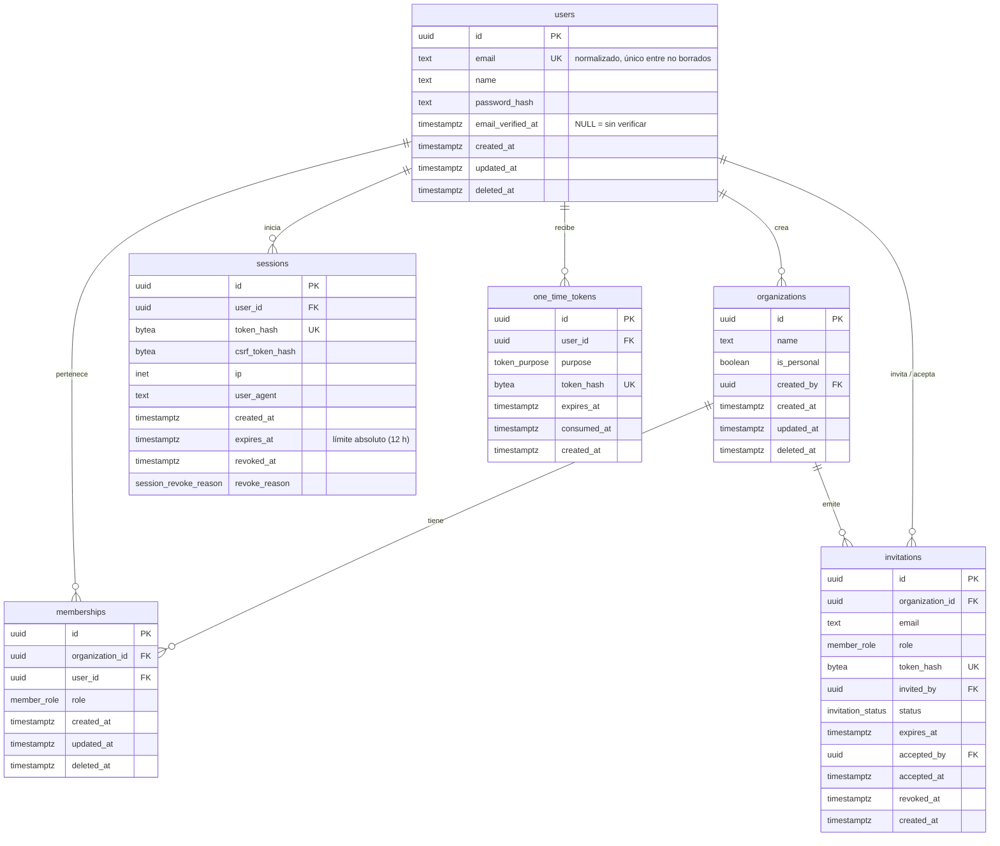

# Data Model: Identidad y multi-tenant (F1)

> **Estado: APROBADO por el autor el 2026-10-29.** Cualquier cambio posterior requiere nueva
> revisión del autor.
>
> Modificado el 2026-10-29 con aprobación del autor: `deleted_at` fuera de las políticas de RLS
> (opción A). Ver la nota de "Aislamiento".
>
> Modificado el 2026-10-29 con aprobación del autor: lectura de `organizations` con token de
> invitación pendiente (opción B). Ver la nota de "Aislamiento".

Base de datos: PostgreSQL 18, esquema `public`. Decisiones de soporte en [research.md](./research.md)
(R2 identificadores, R3 borrado lógico, R5 sesiones, R8 RLS, R9 roles).

## Convenciones

| Convención | Regla |
|---|---|
| Nombres | `snake_case`; tablas en plural |
| Clave primaria | `id uuid PRIMARY KEY DEFAULT uuidv7()` |
| Fechas | `timestamptz`, en UTC; `created_at NOT NULL DEFAULT now()` en todas las tablas |
| `updated_at` | Solo en tablas editables (`users`, `organizations`, `memberships`); lo actualiza un trigger |
| Borrado lógico | `deleted_at timestamptz NULL` en `users`, `organizations`, `memberships` |
| Hashes | `bytea` de 32 bytes (SHA-256) con `CHECK (octet_length(x) = 32)` |
| Textos | `text` con `CHECK` de longitud en vez de `varchar(n)` |
| Claves foráneas | `ON DELETE RESTRICT` en todas: nunca hay borrado físico en cascada |

## Diagrama entidad-relación

## Tipos enumerados

| Tipo | Valores |
|---|---|
| `member_role` | `owner`, `editor`, `viewer` |
| `token_purpose` | `email_verification`, `password_reset` |
| `invitation_status` | `pending`, `accepted`, `revoked` (el vencimiento se deriva de `expires_at`) |
| `session_revoke_reason` | `logout`, `password_change`, `password_reset`, `idle_timeout` |

## Tablas

### `users` — identidad global (no pertenece a una organización)

| Columna | Tipo | Nulo | Default | Restricciones |
|---|---|---|---|---|
| `id` | `uuid` | no | `uuidv7()` | PK |
| `email` | `text` | no | — | `CHECK (email = lower(btrim(email)))`, `CHECK (char_length(email) BETWEEN 3 AND 254)` |
| `name` | `text` | no | — | `CHECK (char_length(name) BETWEEN 1 AND 100)` |
| `password_hash` | `text` | no | — | formato PHC de Argon2id |
| `email_verified_at` | `timestamptz` | sí | — | |
| `created_at` | `timestamptz` | no | `now()` | |
| `updated_at` | `timestamptz` | no | `now()` | trigger |
| `deleted_at` | `timestamptz` | sí | — | |

Índices: `UNIQUE (email) WHERE deleted_at IS NULL`.

Preparado para MFA (F8): el segundo factor irá en una tabla `user_authenticators` nueva, sin
modificar `users`.

### `organizations`

| Columna | Tipo | Nulo | Default | Restricciones |
|---|---|---|---|---|
| `id` | `uuid` | no | `uuidv7()` | PK |
| `name` | `text` | no | — | `CHECK (char_length(name) BETWEEN 1 AND 100)` |
| `is_personal` | `boolean` | no | `false` | |
| `created_by` | `uuid` | no | — | FK → `users.id` |
| `created_at` | `timestamptz` | no | `now()` | |
| `updated_at` | `timestamptz` | no | `now()` | trigger |
| `deleted_at` | `timestamptz` | sí | — | `CHECK (NOT (is_personal AND deleted_at IS NOT NULL))` |

Índices: `UNIQUE (created_by) WHERE is_personal AND deleted_at IS NULL` (una sola organización
personal por usuario).

### `memberships`

| Columna | Tipo | Nulo | Default | Restricciones |
|---|---|---|---|---|
| `id` | `uuid` | no | `uuidv7()` | PK |
| `organization_id` | `uuid` | no | — | FK → `organizations.id` |
| `user_id` | `uuid` | no | — | FK → `users.id` |
| `role` | `member_role` | no | — | |
| `created_at` | `timestamptz` | no | `now()` | |
| `updated_at` | `timestamptz` | no | `now()` | trigger |
| `deleted_at` | `timestamptz` | sí | — | |

Índices: `UNIQUE (organization_id, user_id) WHERE deleted_at IS NULL`; `(user_id) WHERE
deleted_at IS NULL` para listar las organizaciones de un usuario.

Invariante "siempre al menos un owner" (FR-024): trigger `memberships_keep_owner` `AFTER UPDATE`
que falla si la organización queda sin membresías `owner` activas. La aplicación lo valida antes con
un mensaje claro; el trigger es la segunda capa.

### `sessions`

| Columna | Tipo | Nulo | Default | Restricciones |
|---|---|---|---|---|
| `id` | `uuid` | no | `uuidv7()` | PK |
| `user_id` | `uuid` | no | — | FK → `users.id` |
| `token_hash` | `bytea` | no | — | 32 bytes; `UNIQUE` |
| `csrf_token_hash` | `bytea` | no | — | 32 bytes |
| `ip` | `inet` | no | — | |
| `user_agent` | `text` | sí | — | `CHECK (char_length(user_agent) <= 512)` |
| `created_at` | `timestamptz` | no | `now()` | |
| `expires_at` | `timestamptz` | no | — | `created_at + 12 h` |
| `revoked_at` | `timestamptz` | sí | — | |
| `revoke_reason` | `session_revoke_reason` | sí | — | `CHECK ((revoked_at IS NULL) = (revoke_reason IS NULL))` |

Índices: `(user_id) WHERE revoked_at IS NULL` para revocar todas las sesiones de un usuario.

Sesión válida = `revoked_at IS NULL AND now() < expires_at` en PostgreSQL **y** la clave
`sess:<token_hash>` existe en Valkey. La inactividad (2 h) vive solo en Valkey: el TTL de la clave
se renueva con cada petición. Si la clave no existe (inactividad o Valkey vaciado), la sesión se
trata como expirada y se marca revocada con `idle_timeout`; no se puede distinguir un caso del otro, así que se falla
cerrado. Si Valkey no responde, 503.

### `one_time_tokens`

| Columna | Tipo | Nulo | Default | Restricciones |
|---|---|---|---|---|
| `id` | `uuid` | no | `uuidv7()` | PK |
| `user_id` | `uuid` | no | — | FK → `users.id` |
| `purpose` | `token_purpose` | no | — | |
| `token_hash` | `bytea` | no | — | 32 bytes; `UNIQUE` |
| `expires_at` | `timestamptz` | no | — | verificación 24 h, restablecimiento 30 min |
| `consumed_at` | `timestamptz` | sí | — | |
| `created_at` | `timestamptz` | no | `now()` | |

Al emitir un token nuevo para el mismo usuario y propósito, los anteriores sin consumir se marcan
como consumidos.

### `invitations`

| Columna | Tipo | Nulo | Default | Restricciones |
|---|---|---|---|---|
| `id` | `uuid` | no | `uuidv7()` | PK |
| `organization_id` | `uuid` | no | — | FK → `organizations.id` |
| `email` | `text` | no | — | normalizado como en `users` |
| `role` | `member_role` | no | — | |
| `token_hash` | `bytea` | no | — | 32 bytes; `UNIQUE` |
| `invited_by` | `uuid` | no | — | FK → `users.id` |
| `status` | `invitation_status` | no | `'pending'` | |
| `expires_at` | `timestamptz` | no | — | `created_at + 7 días` |
| `accepted_by` | `uuid` | sí | — | FK → `users.id` |
| `accepted_at` | `timestamptz` | sí | — | |
| `revoked_at` | `timestamptz` | sí | — | |
| `created_at` | `timestamptz` | no | `now()` | |

Restricciones de estado: `accepted` exige `accepted_by` y `accepted_at`; `revoked` exige
`revoked_at`. Índice: `UNIQUE (organization_id, email) WHERE status = 'pending'`.

## Aislamiento: políticas de RLS

Todas las tablas: `ENABLE ROW LEVEL SECURITY` y `FORCE ROW LEVEL SECURITY`. Contexto por transacción
(`set_config(..., true)`): `app.user_id`, `app.organization_id`, `app.lookup_email`,
`app.lookup_token_hash`. Abajo, `ctx(x)` = `current_setting('app.x', true)`.

| Tabla | Lectura (`SELECT`) | Escritura |
|---|---|---|
| `users` | `id = ctx(user_id)` o `email = ctx(lookup_email)` o el usuario es miembro activo de `ctx(organization_id)` | `INSERT` libre (registro); `UPDATE` solo `id = ctx(user_id)` |
| `organizations` | existe membresía activa de `ctx(user_id)`, o existe una invitación `pending` y no vencida de esa organización con `token_hash = ctx(lookup_token_hash)` | `INSERT` con `created_by = ctx(user_id)`; `UPDATE` si `id = ctx(organization_id)` |
| `memberships` | `user_id = ctx(user_id)` o `organization_id = ctx(organization_id)` | `INSERT` y `UPDATE` si `organization_id = ctx(organization_id)` |
| `sessions` | `user_id = ctx(user_id)` o `token_hash = ctx(lookup_token_hash)` | `INSERT` y `UPDATE` con la misma condición |
| `one_time_tokens` | `user_id = ctx(user_id)` o `token_hash = ctx(lookup_token_hash)` | igual |
| `invitations` | `organization_id = ctx(organization_id)` o `token_hash = ctx(lookup_token_hash)` | `INSERT` y `UPDATE` con la misma condición |

Notas:
- En SQL, `ctx(x)` es `nullif(current_setting('app.x', true), '')` (un ajuste local a la transacción queda como texto vacío, no
  NULL, al volver la conexión al pool) y `ctx(lookup_token_hash)` es el SHA-256 en hexadecimal, decodificado a
  `bytea`.
- **`deleted_at` no forma parte de las políticas de lectura** (opción A, aprobada por el autor). PostgreSQL
  aplica también la política `SELECT` a la fila nueva de un `UPDATE` que lee columnas (`WHERE` o
  `RETURNING`); con `deleted_at IS NULL` en la política, `UPDATE ... SET deleted_at = now() WHERE id = ...`
  falla con "new row violates row-level security policy" (verificado en PostgreSQL 18.6 como
  `app_runtime`). El aislamiento entre organizaciones no cambia: las filas borradas siguen siendo
  invisibles e intocables desde otra organización. El filtro `deleted_at IS NULL` vive en un único lugar,
  los selectores `active` de `packages/db`, y una regla de ESLint prohíbe en `apps/api` leer `users`,
  `organizations` y `memberships` sin ellos. El trigger `memberships_keep_owner` cuenta solo owners
  activos.
- **`organizations` legible con el token de una invitación pendiente** (opción B, aprobada por el autor;
  migración `0002_organizations_read_by_invitation`). La vista previa de una invitación muestra el
  nombre de la organización a quien aún no es miembro. La política añade a la condición de membresía
  `OR EXISTS (SELECT 1 FROM invitations i WHERE i.organization_id = organizations.id AND i.token_hash =
  ctx(lookup_token_hash) AND i.status = 'pending' AND i.expires_at > now())`. RLS es por fila: con un
  token válido toda la fila de la organización es legible (no solo el nombre); el endpoint de vista
  previa selecciona únicamente `name`. Con una invitación vencida, revocada, aceptada, un token
  desconocido o el token de otra organización se obtienen 0 filas; las políticas de escritura no
  cambian y el acceso de los miembros tampoco.
- El registro crea usuario, organización personal y membresía en una transacción. Como
  `INSERT ... RETURNING` exige que la fila nueva cumpla la política de lectura, los ids se generan
  primero con `SELECT uuidv7()`, se fija `app.user_id` y `app.organization_id` con ellos y luego se
  insertan las filas.
- Las políticas de `UPDATE` permiten marcar `deleted_at` (borrado lógico) dentro de la misma
  organización; la aplicación deja de leer la fila a través de `active`.
- Una prueba dedicada conecta como `app_runtime` sin contexto y verifica que no ve ninguna fila de
  ninguna tabla (SC-003).

## Privilegios

| Tabla | `app_runtime` | `app_migrator` |
|---|---|---|
| `users`, `organizations`, `memberships`, `sessions`, `one_time_tokens`, `invitations` | `SELECT`, `INSERT`, `UPDATE` | dueño |
| Esquema | `USAGE` | dueño; único que ejecuta migraciones |

`app_runtime` no tiene `DELETE` ni `TRUNCATE` en ninguna tabla, ni `BYPASSRLS`. La limpieza de
sesiones y tokens vencidos se hace con una tarea de mantenimiento como `app_migrator` (fuera de F1).

## Eventos de seguridad

No hay tabla de auditoría en F1 (decisión del autor). Los eventos de seguridad (registro, login
exitoso y fallido, logout, rate limit, restablecimiento y cambio de contraseña, invitaciones, cambios
de rol y expulsiones) se emiten como logs estructurados con `event`, `outcome`, `userId`,
`organizationId`, `ip` y `correlationId`, sin datos sensibles. La consulta por owners desde la
aplicación queda para una fase posterior.

## Datos en Valkey (no persistentes)

| Clave | Contenido | TTL |
|---|---|---|
| `sess:<token_hash hex>` | `user_id`, `csrf_token_hash`, `expires_at` | 2 h, renovado en cada petición (inactividad) |
| `rl:login:account:<sha256(email)>` | contador y espera progresiva | 15 min desde el último fallo |
| `rl:login:ip:<ip>` | contador y espera progresiva | 15 min desde el último fallo |
| `rl:register:ip:<ip>`, `rl:reset:email:<sha256(email)>`, `rl:invite:org:<id>` | contadores fijos | según el límite |

PostgreSQL es la fuente de verdad de revocación y vida absoluta; Valkey lo es solo de la inactividad.
Si Valkey se vacía, todas las sesiones expiran (hay que iniciar sesión de nuevo) y los contadores de
rate limit empiezan de cero.
