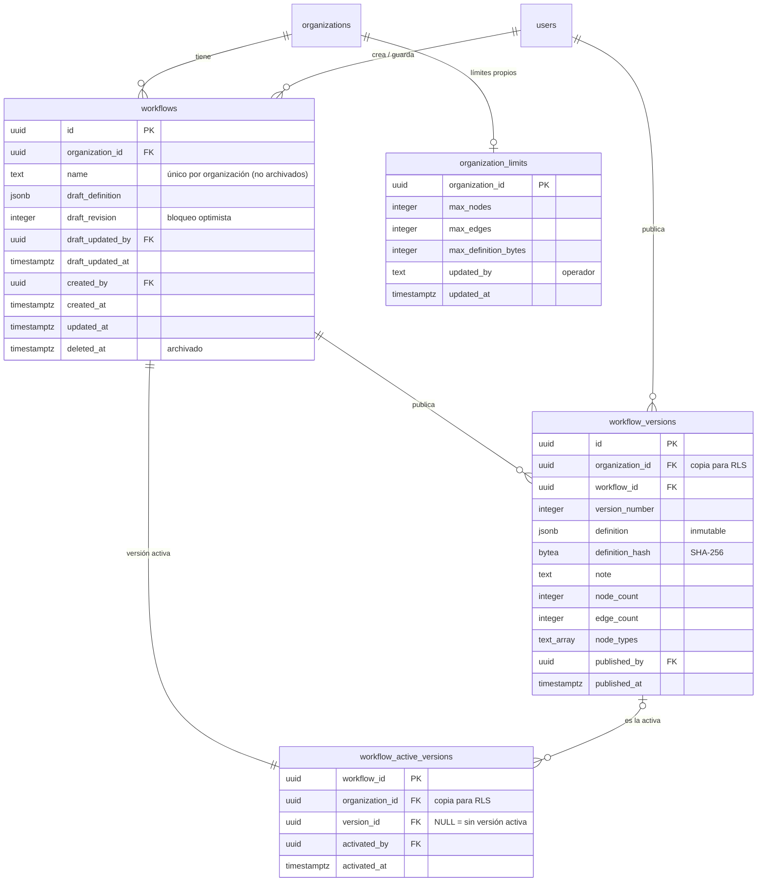

# Data Model: Modelo DAG y editor visual (F2)

> **Estado: APROBADO por el autor el 2026-10-30**, con la tabla puente `workflow_active_versions`
> (opción C) en lugar de `workflows.active_version_id`.

Se agregan 4 tablas al esquema de F1. Mismas convenciones: `uuidv7()`, `timestamptz` en UTC, `CHECK`
de longitud, claves foráneas `ON DELETE RESTRICT`, RLS forzado y borrado lógico filtrado en
`packages/db` (opción A de F1, no en las políticas). No se modifica ninguna tabla de F1.

## Diagrama entidad-relación

## Tablas

### `workflows` — un workflow con su borrador

| Columna | Tipo | Nulo | Default | Restricciones |
|---|---|---|---|---|
| `id` | `uuid` | no | `uuidv7()` | PK |
| `organization_id` | `uuid` | no | — | FK → `organizations.id` |
| `name` | `text` | no | — | `CHECK (char_length(name) BETWEEN 1 AND 100)` |
| `draft_definition` | `jsonb` | no | DAG vacío `{"schemaVersion":1,"nodes":[],"edges":[]}` | `CHECK (octet_length(draft_definition::text) <= 1048576)` (tope absoluto de 1 MB; el límite real lo valida la aplicación) |
| `draft_revision` | `integer` | no | `1` | `CHECK (draft_revision >= 1)`; se incrementa en cada guardado |
| `draft_updated_by` | `uuid` | no | — | FK → `users.id` |
| `draft_updated_at` | `timestamptz` | no | `now()` | |
| `created_by` | `uuid` | no | — | FK → `users.id` |
| `created_at` | `timestamptz` | no | `now()` | |
| `updated_at` | `timestamptz` | no | `now()` | trigger |
| `deleted_at` | `timestamptz` | sí | — | archivado; un trigger desactiva su versión activa (ver `workflow_active_versions`) |

Índices: `UNIQUE (organization_id, name) WHERE deleted_at IS NULL`; `(organization_id) WHERE
deleted_at IS NULL` para listar.

El borrador **puede** contener errores de validación (FR-010); solo el tamaño tiene tope en base de
datos.

### `workflow_versions` — inmutable

| Columna | Tipo | Nulo | Default | Restricciones |
|---|---|---|---|---|
| `id` | `uuid` | no | `uuidv7()` | PK |
| `organization_id` | `uuid` | no | — | FK → `organizations.id`; debe coincidir con la del workflow (trigger de verificación) |
| `workflow_id` | `uuid` | no | — | FK → `workflows.id` |
| `version_number` | `integer` | no | — | `CHECK (version_number >= 1)` |
| `definition` | `jsonb` | no | — | mismo tope de 1 MB |
| `definition_hash` | `bytea` | no | — | 32 bytes: SHA-256 de la definición canónica; permite verificar que no cambió (SC-006) |
| `note` | `text` | sí | — | `CHECK (char_length(note) <= 500)` |
| `node_count` | `integer` | no | — | `CHECK (node_count >= 1)` (columna derivada) |
| `edge_count` | `integer` | no | — | `CHECK (edge_count >= 0)` (columna derivada) |
| `node_types` | `text[]` | no | — | tipos usados, ordenados y sin repetir (columna derivada) |
| `published_by` | `uuid` | no | — | FK → `users.id` |
| `published_at` | `timestamptz` | no | `now()` | |

Índices: `UNIQUE (workflow_id, version_number)` (evita versiones duplicadas al publicar en paralelo);
`UNIQUE (id, workflow_id)` (destino de la FK compuesta de `workflow_active_versions`); índice GIN sobre
`node_types` para consultas como "qué workflows usan `http.request`".

Sin `updated_at` ni `deleted_at`: una versión nunca cambia ni se borra. Al archivar un workflow, sus
versiones se conservan.

### `workflow_active_versions` — cuál versión está activa

Tabla puente (decisión del autor, opción C): evita la referencia circular entre `workflows` y
`workflow_versions` y mantiene las versiones inmutables. Una fila por workflow, creada junto con el
workflow.

| Columna | Tipo | Nulo | Default | Restricciones |
|---|---|---|---|---|
| `workflow_id` | `uuid` | no | — | PK y FK → `workflows.id` |
| `organization_id` | `uuid` | no | — | FK → `organizations.id`; debe coincidir con la del workflow (trigger de verificación) |
| `version_id` | `uuid` | sí | — | FK compuesta `(version_id, workflow_id)` → `workflow_versions(id, workflow_id)`: la versión activa siempre es de este workflow; `NULL` = sin versión activa |
| `activated_by` | `uuid` | sí | — | FK → `users.id`; quién activó la versión actual |
| `activated_at` | `timestamptz` | sí | — | `CHECK ((version_id IS NULL) = (activated_at IS NULL))` |

Publicar inserta la versión y actualiza esta fila; reactivar una versión anterior solo actualiza esta
fila; archivar el workflow deja `version_id` en `NULL`.

### `organization_limits` — límites propios (opcional por organización)

| Columna | Tipo | Nulo | Default | Restricciones |
|---|---|---|---|---|
| `organization_id` | `uuid` | no | — | PK y FK → `organizations.id` |
| `max_nodes` | `integer` | no | — | `CHECK (max_nodes BETWEEN 1 AND 500)` |
| `max_edges` | `integer` | no | — | `CHECK (max_edges BETWEEN 0 AND 1000)` |
| `max_definition_bytes` | `integer` | no | — | `CHECK (max_definition_bytes BETWEEN 1024 AND 1048576)` |
| `updated_by` | `text` | no | — | identificador del operador, 1–100 caracteres |
| `updated_at` | `timestamptz` | no | `now()` | |

Sin fila = se aplican los valores por defecto de la plataforma (50 / 100 / 256 KB). Los rangos de los
`CHECK` son el tope absoluto; la configuración del servidor puede fijar topes menores.

## Aislamiento: políticas de RLS

`ENABLE` + `FORCE ROW LEVEL SECURITY` en las 4 tablas. `ctx(x)` = `current_setting('app.x', true)`.

| Tabla | Lectura (`SELECT`) | Escritura |
|---|---|---|
| `workflows` | `organization_id = ctx(organization_id)` | `INSERT` y `UPDATE` con la misma condición |
| `workflow_versions` | `organization_id = ctx(organization_id)` | `INSERT` con la misma condición; sin `UPDATE` |
| `workflow_active_versions` | `organization_id = ctx(organization_id)` | `INSERT` y `UPDATE` con la misma condición |
| `organization_limits` | `organization_id = ctx(organization_id)` | ninguna para `app_runtime` |

Quién puede editar o publicar (owner y editor) lo decide el guard de organización de F1 en la
aplicación; RLS garantiza el aislamiento entre organizaciones.

## Privilegios

| Tabla | `app_runtime` | `app_migrator` |
|---|---|---|
| `workflows` | `SELECT`, `INSERT`, `UPDATE` | dueño |
| `workflow_versions` | `SELECT`, `INSERT` | dueño |
| `workflow_active_versions` | `SELECT`, `INSERT`, `UPDATE` | dueño |
| `organization_limits` | `SELECT` | dueño; el script del operador escribe con este rol |

Sin `DELETE` ni `TRUNCATE` en ninguna. La inmutabilidad de las versiones queda garantizada por la base
de datos, no solo por el código.

## Triggers

- `workflows_set_updated_at`: actualiza `updated_at` (como en F1).
- `workflow_versions_same_organization` y `workflow_active_versions_same_organization`: `BEFORE
  INSERT OR UPDATE`, fallan si `organization_id` no coincide con la del workflow.
- `workflows_archive_deactivates`: `AFTER UPDATE OF deleted_at` en `workflows`; al archivar, pone
  `version_id`, `activated_by` y `activated_at` en `NULL` en `workflow_active_versions`.

## Valkey

Sin datos nuevos en F2.
