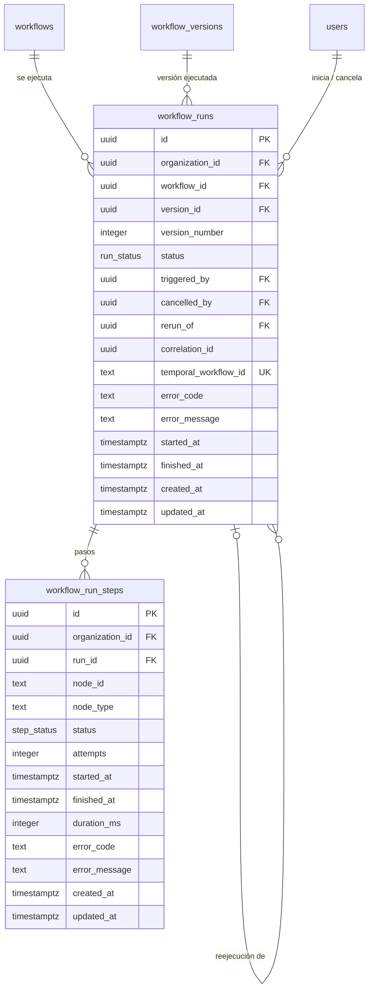

# Data Model: Motor de ejecución (F3)

> **Estado: APROBADO por el autor el 2026-10-30.** Cualquier cambio posterior requiere nueva
> revisión del autor.

Dos tablas nuevas y **una columna nueva** en `organization_limits` (tabla de F2). Mismas convenciones:
`uuidv7()`, `timestamptz` en UTC, `CHECK` de longitud, FK `ON DELETE RESTRICT`, RLS forzado, sin
`DELETE` para `app_runtime`. Sin contenido de entradas ni salidas (decisión 5C).

## Diagrama entidad-relación

## Tipos enumerados

| Tipo | Valores |
|---|---|
| `run_status` | `queued`, `running`, `succeeded`, `failed`, `cancelled`, `timed_out` |
| `step_status` | `pending`, `running`, `succeeded`, `failed`, `skipped`, `cancelled` |

## Tablas

### `workflow_runs`

| Columna | Tipo | Nulo | Default | Restricciones |
|---|---|---|---|---|
| `id` | `uuid` | no | — | PK; lo genera el API (UUID v7) antes de iniciar en Temporal |
| `organization_id` | `uuid` | no | — | FK → `organizations.id`; igual a la del workflow (trigger) |
| `workflow_id` | `uuid` | no | — | FK → `workflows.id` |
| `version_id` | `uuid` | no | — | FK compuesta `(version_id, workflow_id)` → `workflow_versions(id, workflow_id)` |
| `version_number` | `integer` | no | — | copia para listar sin join; `CHECK (>= 1)` |
| `status` | `run_status` | no | `'queued'` | |
| `triggered_by` | `uuid` | no | — | FK → `users.id` |
| `cancelled_by` | `uuid` | sí | — | FK → `users.id`; solo si `status = 'cancelled'` |
| `rerun_of` | `uuid` | sí | — | FK → `workflow_runs.id` |
| `correlation_id` | `uuid` | no | — | |
| `temporal_workflow_id` | `text` | no | — | `UNIQUE`; `run-<id>` |
| `error_code` | `text` | sí | — | `CHECK (char_length <= 64)` |
| `error_message` | `text` | sí | — | `CHECK (char_length <= 500)`; resumen sin datos de entrada |
| `started_at` | `timestamptz` | sí | — | |
| `finished_at` | `timestamptz` | sí | — | `CHECK` coherente: obligatorio en estados terminales, nulo en `queued`/`running` |
| `created_at` | `timestamptz` | no | `now()` | |
| `updated_at` | `timestamptz` | no | `now()` | trigger |

Índices: `(workflow_id, created_at DESC)` para listar; `(organization_id) WHERE status IN ('queued',
'running')` para el límite de ejecuciones simultáneas.

### `workflow_run_steps`

| Columna | Tipo | Nulo | Default | Restricciones |
|---|---|---|---|---|
| `id` | `uuid` | no | `uuidv7()` | PK |
| `organization_id` | `uuid` | no | — | FK → `organizations.id`; igual a la de la ejecución (trigger) |
| `run_id` | `uuid` | no | — | FK → `workflow_runs.id` |
| `node_id` | `text` | no | — | `CHECK (node_id ~ '^[a-z][a-z0-9_]{0,39}$')` |
| `node_type` | `text` | no | — | `CHECK (char_length <= 40)` |
| `status` | `step_status` | no | `'pending'` | |
| `attempts` | `integer` | no | `0` | `CHECK (attempts >= 0)` |
| `started_at` | `timestamptz` | sí | — | |
| `finished_at` | `timestamptz` | sí | — | |
| `duration_ms` | `integer` | sí | — | `CHECK (duration_ms >= 0)` |
| `error_code` | `text` | sí | — | como en `workflow_runs` |
| `error_message` | `text` | sí | — | como en `workflow_runs` |
| `created_at` | `timestamptz` | no | `now()` | |
| `updated_at` | `timestamptz` | no | `now()` | trigger |

Índice: `UNIQUE (run_id, node_id)` (un paso por nodo y ejecución; las escrituras repetidas de una
activity reintentada actualizan la misma fila).

### Cambio en `organization_limits` (F2)

| Columna nueva | Tipo | Nulo | Default | Restricciones |
|---|---|---|---|---|
| `max_concurrent_runs` | `integer` | no | `5` | `CHECK (max_concurrent_runs BETWEEN 1 AND 100)` |

Sin fila de límites para una organización = valores por defecto de la plataforma (incluido 5). El
operador la cambia con el mismo script de F2.

## Aislamiento y privilegios

| Tabla | RLS (lectura y escritura) | `app_runtime` |
|---|---|---|
| `workflow_runs` | `organization_id = ctx(organization_id)` | `SELECT`, `INSERT`, `UPDATE` |
| `workflow_run_steps` | `organization_id = ctx(organization_id)` | `SELECT`, `INSERT`, `UPDATE` |

`ENABLE` + `FORCE ROW LEVEL SECURITY` en ambas; sin `DELETE` ni `TRUNCATE`. El worker escribe como
`app_runtime` con el contexto de la organización que viaja en la entrada del workflow.

## Triggers

- `updated_at` en ambas tablas.
- `workflow_runs_same_organization` y `workflow_run_steps_same_organization` (`BEFORE INSERT OR UPDATE`).
- `workflow_runs_terminal_immutable`: una ejecución en estado terminal no puede volver a otro estado.

## Valkey

| Clave / canal | Uso |
|---|---|
| canal `run:<runId>` | eventos de cambio de estado para la vista en vivo (pub/sub, sin persistencia) |
