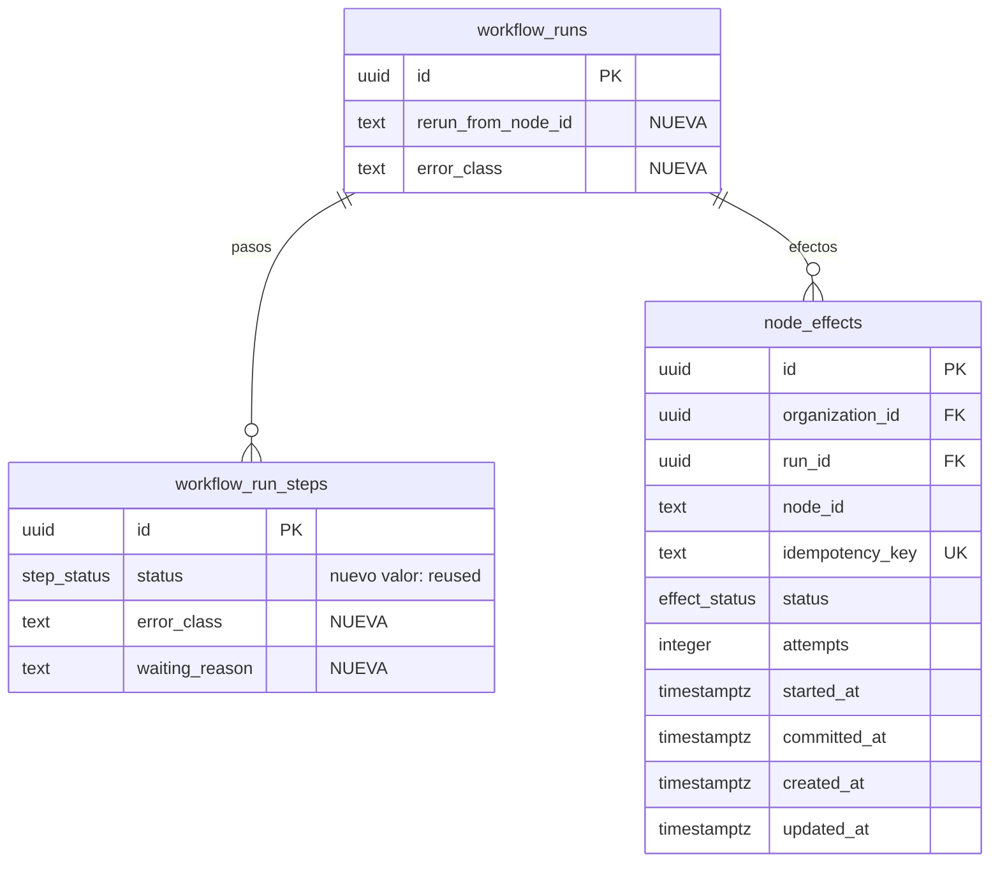

# Data Model: Resiliencia (F4)

> **Estado: APROBADO por el autor el 2026-10-31.** Cualquier cambio posterior requiere nueva
> revisión del autor.

Una tabla nueva (`node_effects`), un valor nuevo en `step_status`, tres columnas nuevas y dos índices.
Mismas convenciones de F1–F3: `uuidv7()`, `timestamptz` en UTC, `CHECK` de longitud, FK
`ON DELETE RESTRICT`, RLS forzado, sin `DELETE` para `app_runtime`. Sin contenido de entradas ni
salidas (decisión 5C de F3).

## Diagrama entidad-relación (solo lo nuevo o cambiado)

## Tipos enumerados

| Tipo | Valores | Cambio |
|---|---|---|
| `step_status` | `pending`, `running`, `succeeded`, `failed`, `skipped`, `cancelled`, **`reused`** | valor nuevo; `reused` es terminal |
| `effect_status` | `started`, `committed` | tipo nuevo |

La clase de error se guarda como `text` con `CHECK` (no enum) porque F5 agrega clases
(`invalid_output`, `budget_exhausted`) y un `CHECK` se amplía sin reescribir el tipo.

## Tabla nueva: `node_effects`

| Columna | Tipo | Nulo | Default | Restricciones |
|---|---|---|---|---|
| `id` | `uuid` | no | `uuidv7()` | PK |
| `organization_id` | `uuid` | no | — | FK → `organizations.id`; igual a la de la ejecución (trigger) |
| `run_id` | `uuid` | no | — | FK → `workflow_runs.id` |
| `node_id` | `text` | no | — | mismo `CHECK` que en `workflow_run_steps` |
| `idempotency_key` | `text` | no | — | `UNIQUE`; `CHECK (idempotency_key = run_id::text || ':' || node_id)` |
| `status` | `effect_status` | no | `'started'` | |
| `attempts` | `integer` | no | `1` | `CHECK (attempts >= 1)`; veces que se intentó el efecto |
| `started_at` | `timestamptz` | no | `now()` | primer intento |
| `committed_at` | `timestamptz` | sí | — | `CHECK`: obligatorio si `committed`, nulo si `started` |
| `created_at` | `timestamptz` | no | `now()` | |
| `updated_at` | `timestamptz` | no | `now()` | trigger |

Índice: `UNIQUE (idempotency_key)`; `(run_id)` para consultar los efectos de una ejecución.

Trigger `node_effects_committed_immutable`: un efecto `committed` no vuelve a `started`.

## Cambios en `workflow_runs` (F3)

| Columna nueva | Tipo | Nulo | Default | Restricciones |
|---|---|---|---|---|
| `rerun_from_node_id` | `text` | sí | — | mismo `CHECK` de formato que `node_id`; `CHECK (rerun_from_node_id IS NULL OR rerun_of IS NOT NULL)` |
| `error_class` | `text` | sí | — | `CHECK (error_class IN ('transient','rate_limited','timeout','permanent'))`; solo en `failed`/`timed_out` |

Índices nuevos: `(organization_id, created_at DESC)` para el listado de la organización;
`(organization_id, created_at DESC) WHERE status = 'failed'` para el filtro de fallidas.

## Cambios en `workflow_run_steps` (F3)

| Columna nueva | Tipo | Nulo | Default | Restricciones |
|---|---|---|---|---|
| `error_class` | `text` | sí | — | mismo `CHECK` que en `workflow_runs`; solo con `status = 'failed'` |
| `waiting_reason` | `text` | sí | — | `CHECK (waiting_reason IN ('rate_limited'))`; solo con `status = 'running'` |

## Aislamiento y privilegios

| Tabla | RLS (lectura y escritura) | `app_runtime` |
|---|---|---|
| `node_effects` | `organization_id = ctx(organization_id)` | `SELECT`, `INSERT`, `UPDATE` |

`ENABLE` + `FORCE ROW LEVEL SECURITY`; sin `DELETE` ni `TRUNCATE`. El worker escribe como
`app_runtime` con el contexto de la organización de la ejecución.

## Triggers

- `updated_at` y `node_effects_same_organization` (`BEFORE INSERT OR UPDATE`) en `node_effects`.
- `node_effects_committed_immutable`.
- `workflow_runs_terminal_immutable` (F3) sin cambios; `reused` se trata como terminal en los pasos.

## Valkey

| Clave | Uso |
|---|---|
| `rl:<organizationId>:<nodeType>` | token bucket (hash `tokens`, `updatedAt`), con TTL |
| `mock:effect:<idempotencyKey>` | registro del destino simulado para deduplicar efectos repetidos (TTL 7 días) |

## Sin cambios de tablas

- Ajustes de reintento por nodo: viven en la definición del DAG (JSON de la versión).
- Cuotas diarias, circuit breaker y bulkheads: fuera de F4.
