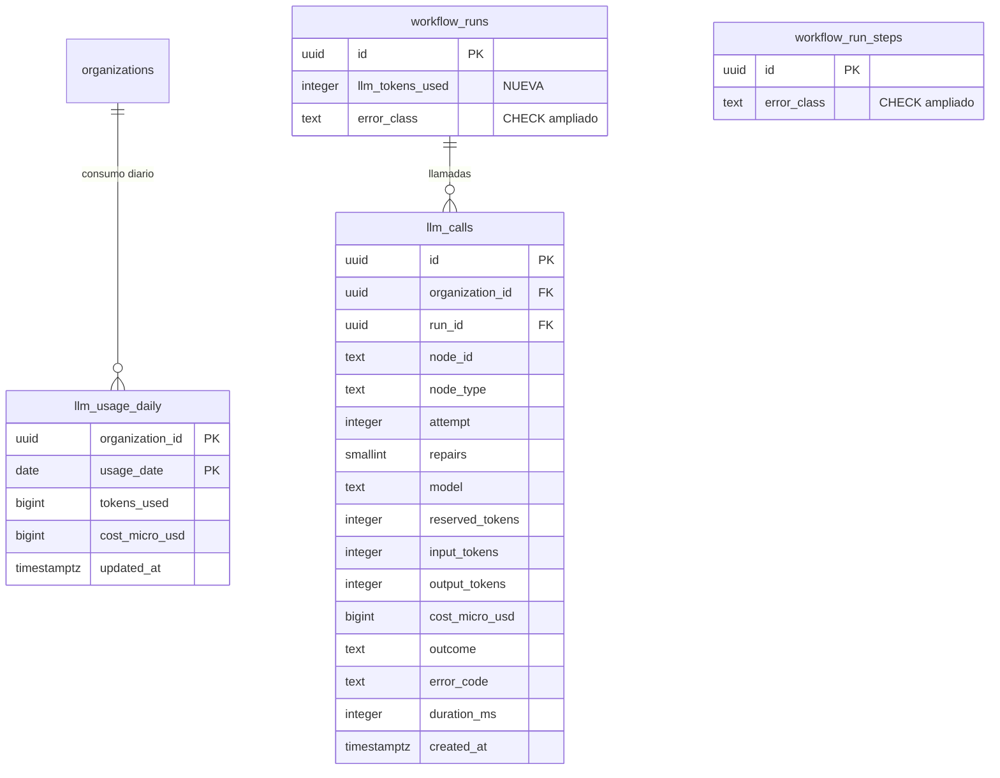

# Data Model: Nodos cognitivos (F5)

> **Estado: APROBADO por el autor el 2026-11-05.** Cualquier cambio posterior requiere nueva
> revisión del autor.

Dos tablas nuevas (`llm_calls`, `llm_usage_daily`), una columna nueva en `workflow_runs` y el `CHECK`
de `error_class` ampliado en `workflow_runs` y `workflow_run_steps`. Mismas convenciones de F1–F4:
`uuidv7()`, `timestamptz` en UTC, `CHECK` de longitud, FK `ON DELETE RESTRICT`, RLS forzado, sin
`DELETE` para `app_runtime`. Sin contenido de prompts ni respuestas (decisión 5C de F3).

## Diagrama entidad-relación (solo lo nuevo o cambiado)



## Tabla nueva: `llm_calls`

Una fila por intento de nodo LLM que llegó a reservar presupuesto (incluye sus reparaciones). Inmutable.

| Columna | Tipo | Nulo | Default | Restricciones |
|---|---|---|---|---|
| `id` | `uuid` | no | `uuidv7()` | PK |
| `organization_id` | `uuid` | no | — | FK → `organizations.id`; igual a la de la ejecución (trigger) |
| `run_id` | `uuid` | no | — | FK → `workflow_runs.id` |
| `node_id` | `text` | no | — | mismo `CHECK` de formato que en `workflow_run_steps` |
| `node_type` | `text` | no | — | `CHECK (node_type IN ('llm.classify','llm.extract','llm.generate'))` |
| `attempt` | `integer` | no | — | `CHECK (attempt >= 1)`; intento de la activity |
| `repairs` | `smallint` | no | `0` | `CHECK (repairs BETWEEN 0 AND 2)` |
| `model` | `text` | no | — | `CHECK (char_length(model) BETWEEN 1 AND 64)` |
| `reserved_tokens` | `integer` | no | — | `CHECK (reserved_tokens >= 0)`; suma de reservas del intento |
| `input_tokens` | `integer` | no | `0` | `CHECK (input_tokens >= 0)` |
| `output_tokens` | `integer` | no | `0` | `CHECK (output_tokens >= 0)` |
| `cost_micro_usd` | `bigint` | no | `0` | `CHECK (cost_micro_usd >= 0)`; estimado |
| `outcome` | `text` | no | — | `CHECK (outcome IN ('succeeded','invalid_output','failed'))` |
| `error_code` | `text` | sí | — | `CHECK` longitud ≤ 64; obligatorio si `outcome <> 'succeeded'`, nulo si no |
| `duration_ms` | `integer` | no | — | `CHECK (duration_ms >= 0)` |
| `created_at` | `timestamptz` | no | `now()` | |

Índices: `(run_id, node_id)` para el consumo por paso y ejecución; `(organization_id, created_at
DESC)` para consultas del operador.

Los fallos por presupuesto agotado no crean fila (no hubo reserva ni llamada); quedan en el paso
(`error_class = 'budget_exhausted'`) y en el evento de seguridad.

## Tabla nueva: `llm_usage_daily`

Contador por organización y día UTC; reservado antes de cada llamada y ajustado después (research R4).

| Columna | Tipo | Nulo | Default | Restricciones |
|---|---|---|---|---|
| `organization_id` | `uuid` | no | — | FK → `organizations.id`; PK compuesta |
| `usage_date` | `date` | no | — | PK compuesta; día UTC de la reserva |
| `tokens_used` | `bigint` | no | `0` | `CHECK (tokens_used >= 0)`; incluye reservas en curso |
| `cost_micro_usd` | `bigint` | no | `0` | `CHECK (cost_micro_usd >= 0)` |
| `updated_at` | `timestamptz` | no | `now()` | trigger |

PK `(organization_id, usage_date)`. El límite diario no se guarda en la tabla: es configuración
(decisión 5A); la reserva lo aplica con `UPDATE ... WHERE tokens_used + $e <= $limite`.

## Cambios en `workflow_runs`

| Columna nueva | Tipo | Nulo | Default | Restricciones |
|---|---|---|---|---|
| `llm_tokens_used` | `integer` | no | `0` | `CHECK (llm_tokens_used >= 0)`; reservado + ajustado de la ejecución |

`workflow_runs_terminal_immutable` (F3) se ajusta para permitir solo el ajuste de `llm_tokens_used`
hacia abajo tras el final (una llamada en vuelo que termina después de cancelarse la ejecución).

## `CHECK` de `error_class` ampliado

En `workflow_runs.error_class` y `workflow_run_steps.error_class`:

```sql
CHECK (error_class IN ('transient','rate_limited','timeout','permanent',
                       'invalid_output','budget_exhausted'))
```

Migración expand: se reemplaza el `CHECK` por uno más amplio; los datos existentes siguen válidos.

## Tipos enumerados

Sin cambios. `outcome` y `error_class` son `text` con `CHECK` (criterio de F4).

## Aislamiento y privilegios

| Tabla | RLS (lectura y escritura) | `app_runtime` |
|---|---|---|
| `llm_calls` | `organization_id = ctx(organization_id)` | `SELECT`, `INSERT` |
| `llm_usage_daily` | `organization_id = ctx(organization_id)` | `SELECT`, `INSERT`, `UPDATE` |

`ENABLE` + `FORCE ROW LEVEL SECURITY`; sin `DELETE` ni `TRUNCATE`. El worker escribe como
`app_runtime` con el contexto de la organización de la ejecución; el API lee con el de la ruta.

## Triggers

- `llm_calls_same_organization` (`BEFORE INSERT`): `organization_id` igual al de la ejecución.
- `llm_calls_immutable` (`BEFORE UPDATE`): rechaza toda modificación.
- `updated_at` en `llm_usage_daily`.

## Valkey

| Clave | Uso |
|---|---|
| `rl:<organizationId>:llm.classify` (y `extract`, `generate`) | token bucket por organización y tipo (F4) |
| `rl:global:<modelo>` | token bucket global por modelo (cuota del proveedor), con TTL |

## Sin cambios de tablas

- `redactPii` y `retry` de los nodos LLM: viven en la definición del DAG (JSON de la versión).
- Límites, precios y modelos: configuración por entorno.
- Cuotas de ejecuciones por día y concurrentes, circuit breaker: fuera de F5.
