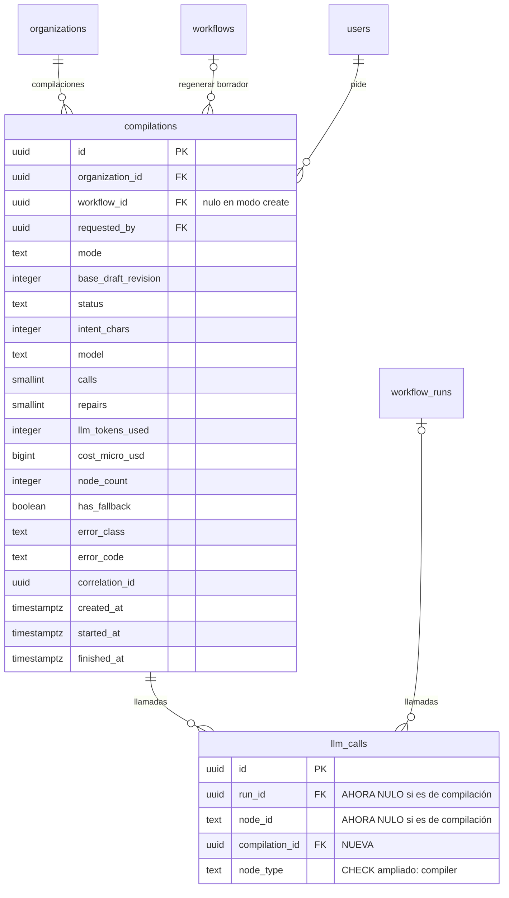

# Data Model: Compilador de lenguaje natural a DAG (F6)

> **Estado: APROBADO por el autor el 2026-11-06.** Cualquier cambio posterior requiere nueva
> revisión del autor.

Una tabla nueva (`compilations`) y `llm_calls` generalizada para pertenecer a una ejecución o a una
compilación. Mismas convenciones de F1–F5: `uuidv7()`, `timestamptz` en UTC, `CHECK` de longitud, FK
`ON DELETE RESTRICT`, RLS forzado, sin `DELETE` para `app_runtime`. Sin la intención ni el DAG
generado en PostgreSQL (decisión 3B): ese contenido vive solo en Temporal.

## Diagrama entidad-relación (solo lo nuevo o cambiado)



## Tabla nueva: `compilations`

Una fila por compilación pedida. Mutable solo en su ciclo de vida (`queued → running → succeeded |
failed`); inmutable al llegar a un estado final.

| Columna | Tipo | Nulo | Default | Restricciones |
|---|---|---|---|---|
| `id` | `uuid` | no | `uuidv7()` | PK; el workflow de Temporal es `compile-<id>` |
| `organization_id` | `uuid` | no | — | FK → `organizations.id` |
| `workflow_id` | `uuid` | sí | — | FK → `workflows.id`; misma organización (trigger) |
| `requested_by` | `uuid` | no | — | FK → `users.id` |
| `mode` | `text` | no | — | `CHECK (mode IN ('create','regenerate'))` |
| `base_draft_revision` | `integer` | sí | — | `CHECK (base_draft_revision >= 1)` |
| `status` | `text` | no | `'queued'` | `CHECK (status IN ('queued','running','succeeded','failed'))` |
| `intent_chars` | `integer` | no | — | `CHECK (intent_chars BETWEEN 1 AND 2000)`; solo el tamaño |
| `model` | `text` | no | — | `CHECK (char_length(model) BETWEEN 1 AND 64)` |
| `calls` | `smallint` | no | `0` | `CHECK (calls BETWEEN 0 AND 3)`; llamadas al proveedor |
| `repairs` | `smallint` | no | `0` | `CHECK (repairs BETWEEN 0 AND 2)` |
| `llm_tokens_used` | `integer` | no | `0` | `CHECK (llm_tokens_used >= 0)`; reservado + ajustado |
| `cost_micro_usd` | `bigint` | no | `0` | `CHECK (cost_micro_usd >= 0)`; estimado |
| `node_count` | `smallint` | sí | — | `CHECK (node_count >= 0)`; nodos del resultado o del fallback |
| `has_fallback` | `boolean` | no | `false` | hay último intento abrible como borrador (9B) |
| `error_class` | `text` | sí | — | mismo `CHECK` de taxonomía que `workflow_runs.error_class` |
| `error_code` | `text` | sí | — | `CHECK` longitud ≤ 64 |
| `correlation_id` | `uuid` | no | — | de la petición HTTP que la creó |
| `created_at` | `timestamptz` | no | `now()` | |
| `started_at` | `timestamptz` | sí | — | |
| `finished_at` | `timestamptz` | sí | — | |

`CHECK` de consistencia:

- `compilations_mode_consistent`: `(mode = 'create' AND workflow_id IS NULL AND base_draft_revision
  IS NULL) OR (mode = 'regenerate' AND workflow_id IS NOT NULL AND base_draft_revision IS NOT NULL)`.
- `compilations_error_consistent`: `status = 'failed'` ⇔ `error_code IS NOT NULL`; `error_class`
  solo si `status = 'failed'`.
- `compilations_finished_consistent`: `finished_at IS NOT NULL` ⇔ `status IN
  ('succeeded','failed')`.
- `compilations_fallback_only_failed`: `has_fallback = false OR status = 'failed'`.

Índices:

- `(organization_id, created_at DESC)`: lista reciente y conteo diario por organización (límite de 50
  por día, R13).
- `(workflow_id, created_at DESC) WHERE workflow_id IS NOT NULL`: compilaciones recientes de un
  workflow.

## Cambios en `llm_calls`

| Columna | Cambio | Restricciones |
|---|---|---|
| `run_id` | pasa a `NULL` permitido | — |
| `node_id` | pasa a `NULL` permitido | el `CHECK` de formato se aplica solo si no es nulo |
| `compilation_id` | **nueva**, `uuid` nulo | FK → `compilations.id` |
| `node_type` | `CHECK` ampliado | `IN ('llm.classify','llm.extract','llm.generate','compiler')` |

`CHECK` nuevo `llm_calls_owner_consistent`:

```sql
CHECK (
  (run_id IS NOT NULL AND node_id IS NOT NULL AND compilation_id IS NULL
     AND node_type <> 'compiler')
  OR
  (run_id IS NULL AND node_id IS NULL AND compilation_id IS NOT NULL
     AND node_type = 'compiler')
)
```

Índice nuevo: `(compilation_id) WHERE compilation_id IS NOT NULL`.

Migración expand: quitar `NOT NULL`, agregar la columna y reemplazar los `CHECK` por los ampliados; las
filas de F5 siguen válidas (todas tienen ejecución y nodo).

## Aislamiento y privilegios

| Tabla | RLS (lectura y escritura) | `app_runtime` |
|---|---|---|
| `compilations` | `organization_id = ctx(organization_id)` | `SELECT`, `INSERT`, `UPDATE` |
| `llm_calls` | sin cambios | sin cambios (`SELECT`, `INSERT`) |

`ENABLE` + `FORCE ROW LEVEL SECURITY`; sin `DELETE` ni `TRUNCATE`. La API crea la fila con el contexto
de la ruta; el worker la actualiza con el contexto de la organización de la compilación.

## Triggers

- `compilations_same_organization` (`BEFORE INSERT`): si `workflow_id` no es nulo, la organización del
  workflow es la de la fila.
- `compilations_terminal_immutable` (`BEFORE UPDATE`): rechaza cambios cuando `status` ya es final, y
  rechaza cambiar `organization_id`, `workflow_id`, `requested_by`, `mode`, `base_draft_revision`,
  `intent_chars`, `model`, `correlation_id`, `created_at`.
- `llm_calls_same_organization` (ampliado): compara con la organización de la ejecución o de la
  compilación, según el dueño.
- `llm_calls_immutable`: sin cambios.

## Valkey

| Clave | Uso |
|---|---|
| `rl:compiler:user:<userId>` | token bucket de 10 compilaciones por hora por persona (R13) |
| `rl:global:<modelo>` | sin cambios: el compilador comparte la cuota global por modelo de F5 |

## Sin cambios de tablas

- `llm_usage_daily`: el compilador reserva en la misma fila diaria de la organización.
- `workflows`, `workflow_versions`: aplicar usa los endpoints de F2; nada nuevo en el esquema.
- `sensitiveFields`: vive en el catálogo; el campo saneado se omite del JSON del borrador.
- Modelo, tope por compilación y límites: configuración por entorno (`LLM_MODEL_COMPILER`,
  `LLM_MAX_TOKENS_PER_COMPILATION`, `COMPILER_MAX_PER_USER_HOUR`, `COMPILER_MAX_PER_ORG_DAY`).
