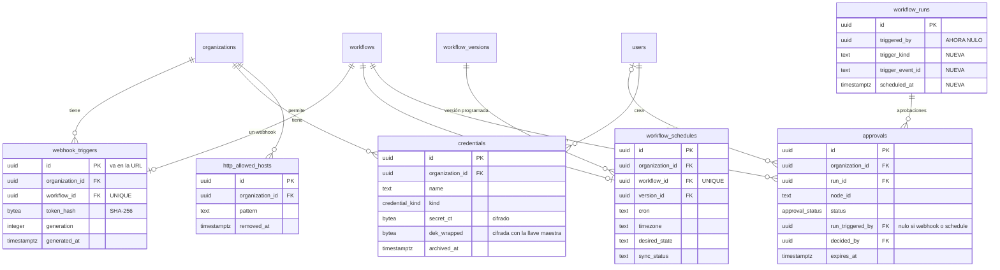

# Data Model: Triggers y control humano (F7)

> **Estado: PENDIENTE de aprobación del autor.** Hasta que el autor lo apruebe no se genera
> `tasks.md` ni se escribe ninguna migración. Cualquier cambio posterior a la aprobación requiere
> nueva revisión del autor.

Cinco tablas nuevas (`webhook_triggers`, `workflow_schedules`, `approvals`, `credentials`,
`http_allowed_hosts`), dos tipos enumerados, cambios en `workflow_runs`, `workflow_run_steps` y
`organization_limits`. Mismas convenciones de F1–F6: `uuidv7()`, `timestamptz` en UTC, `CHECK` de
longitud, FK `ON DELETE RESTRICT`, RLS forzado con la clave de contexto `app.organization_id`, sin
`DELETE` ni `TRUNCATE` para `app_runtime`. Sin contenido en PostgreSQL (decisión 5C de F3): ni el
cuerpo del webhook, ni la respuesta HTTP, ni el mensaje o el comentario de una aprobación, ni ningún
secreto en claro.

Migraciones previstas: `0014_triggers_tables.sql` (tablas, columnas, `CHECK`, índices; expand) y
`0015_triggers_rls_triggers_grants.sql` (RLS, triggers, privilegios; escrita a mano como 0013).

## Diagrama entidad-relación (solo lo nuevo o cambiado)



## Tipos enumerados

| Tipo | Valores | Nota |
|---|---|---|
| `credential_kind` | `bearer`, `api_key_header`, `basic` | tipo nuevo; los tres son cabeceras (decisión 10B) |
| `approval_status` | `pending`, `approved`, `rejected`, `timed_out`, `cancelled` | tipo nuevo; los cuatro últimos son finales |

Los demás dominios cerrados (`trigger_kind`, `desired_state`, `sync_status`) usan `text` con `CHECK`,
como `error_class` en F4: un `CHECK` se amplía sin reescribir un tipo.

## Tabla nueva: `webhook_triggers`

Un webhook por workflow (la validación semántica exige un solo trigger). La fila se crea al generar
el token por primera vez y no se borra. El `id` es público (va en la URL); el secreto es el token, del
que solo se guarda el hash.

| Columna | Tipo | Nulo | Default | Restricciones |
|---|---|---|---|---|
| `id` | `uuid` | no | `uuidv7()` | PK; es el `triggerId` de la URL |
| `organization_id` | `uuid` | no | — | FK → `organizations.id` |
| `workflow_id` | `uuid` | no | — | FK → `workflows.id`; `UNIQUE`; misma organización (trigger) |
| `token_hash` | `bytea` | no | — | `CHECK (octet_length(token_hash) = 32)`; SHA-256 del token |
| `generation` | `integer` | no | `1` | `CHECK (generation >= 1)`; sube 1 en cada regeneración |
| `created_by` | `uuid` | no | — | FK → `users.id`; quien generó el primer token |
| `generated_by` | `uuid` | no | — | FK → `users.id`; quien generó el token vigente |
| `created_at` | `timestamptz` | no | `now()` | |
| `generated_at` | `timestamptz` | no | `now()` | fecha del token vigente |

Índices: `UNIQUE (workflow_id)`. El `id` ya tiene el índice de la PK para buscar por la URL.

## Tabla nueva: `workflow_schedules`

Estado deseado del Temporal Schedule `sched-<workflow_id>` y el resultado de su sincronización. Una
fila por workflow; al desactivar no se borra (sin `DELETE`): pasa a `desired_state = 'removed'`.

| Columna | Tipo | Nulo | Default | Restricciones |
|---|---|---|---|---|
| `id` | `uuid` | no | `uuidv7()` | PK |
| `organization_id` | `uuid` | no | — | FK → `organizations.id` |
| `workflow_id` | `uuid` | no | — | FK → `workflows.id`; `UNIQUE`; misma organización (trigger) |
| `version_id` | `uuid` | no | — | FK compuesta `(version_id, workflow_id)` → `workflow_versions(id, workflow_id)`, como `workflow_runs` |
| `cron` | `text` | no | — | `CHECK (char_length(cron) BETWEEN 9 AND 100)`; la cron de la versión activa |
| `timezone` | `text` | no | `'UTC'` | `CHECK (char_length(timezone) BETWEEN 1 AND 64)`; zona IANA |
| `desired_state` | `text` | no | `'scheduled'` | `CHECK (desired_state IN ('scheduled','removed'))` |
| `sync_status` | `text` | no | `'pending'` | `CHECK (sync_status IN ('pending','synced','failed'))` |
| `sync_attempts` | `smallint` | no | `0` | `CHECK (sync_attempts >= 0)`; se reinicia al cambiar el estado deseado |
| `last_error_code` | `text` | sí | — | `CHECK (char_length(last_error_code) <= 64)`; sin detalle |
| `synced_at` | `timestamptz` | sí | — | |
| `created_at` | `timestamptz` | no | `now()` | |
| `updated_at` | `timestamptz` | no | `now()` | trigger |

`CHECK` de consistencia: `workflow_schedules_sync_consistent`: `sync_status = 'synced'` ⇒
`synced_at IS NOT NULL`; `last_error_code IS NOT NULL` ⇔ `sync_status = 'failed'`.

Índices:

- `UNIQUE (workflow_id)`.
- `(sync_status) WHERE sync_status <> 'synced'`: lo que recorre el reconciliador.
- `(organization_id) WHERE desired_state = 'scheduled'`: cuenta las programaciones activas para el
  tope (`organization_limits.max_active_schedules`).

## Tabla nueva: `approvals`

Una fila por nodo `human.approval` que una ejecución alcanza. La crea el worker con el evento
`approval.requested` y la cierra con `approval.resolved`. Sin mensaje ni comentario: viven en Temporal.

| Columna | Tipo | Nulo | Default | Restricciones |
|---|---|---|---|---|
| `id` | `uuid` | no | `uuidv7()` | PK |
| `organization_id` | `uuid` | no | — | FK → `organizations.id`; igual a la de la ejecución (trigger) |
| `run_id` | `uuid` | no | — | FK → `workflow_runs.id` |
| `workflow_id` | `uuid` | no | — | FK → `workflows.id`; el de la ejecución (trigger) |
| `node_id` | `text` | no | — | mismo `CHECK` de formato que en `workflow_run_steps` |
| `node_label` | `text` | no | — | `CHECK (char_length(node_label) BETWEEN 1 AND 100)`; etiqueta del nodo en la definición |
| `status` | `approval_status` | no | `'pending'` | |
| `run_triggered_by` | `uuid` | sí | — | FK → `users.id`; copia de `workflow_runs.triggered_by` (nulo en webhook y schedule); quien **no** puede decidir |
| `requested_at` | `timestamptz` | no | `now()` | |
| `expires_at` | `timestamptz` | no | — | `CHECK (expires_at > requested_at)` |
| `resolved_at` | `timestamptz` | sí | — | |
| `decided_by` | `uuid` | sí | — | FK → `users.id`; solo si `approved` o `rejected` |
| `has_comment` | `boolean` | no | `false` | indica que hubo comentario; el texto solo está en Temporal |
| `notified_count` | `smallint` | no | `0` | `CHECK (notified_count BETWEEN 0 AND 20)`; correos enviados |

`CHECK` de consistencia:

- `approvals_status_consistent`: `pending` ⇒ `resolved_at IS NULL AND decided_by IS NULL`;
  `approved` o `rejected` ⇒ `resolved_at IS NOT NULL AND decided_by IS NOT NULL`; `timed_out` o
  `cancelled` ⇒ `resolved_at IS NOT NULL AND decided_by IS NULL`.
- `approvals_comment_needs_decider`: `has_comment = false OR decided_by IS NOT NULL`.

Índices:

- `UNIQUE (run_id, node_id)`: una solicitud por nodo y ejecución; hace idempotente el evento del
  worker y sirve para excluir ejecuciones con aprobación pendiente del límite de concurrencia.
- `(organization_id, requested_at DESC) WHERE status = 'pending'`: la bandeja y el contador.
- `(organization_id, resolved_at DESC) WHERE status <> 'pending'`: el historial.

## Tabla nueva: `credentials`

Credenciales de conector de la organización con cifrado de sobre (AES-256-GCM). La llave maestra no
está en la base de datos (`CREDENTIALS_MASTER_KEY`). El secreto se cifra con una llave de datos (DEK)
aleatoria por credencial y la DEK se cifra con la llave maestra; los datos autenticados adicionales
(AAD) son `credential:<id>:<organization_id>`.

| Columna | Tipo | Nulo | Default | Restricciones |
|---|---|---|---|---|
| `id` | `uuid` | no | `uuidv7()` | PK |
| `organization_id` | `uuid` | no | — | FK → `organizations.id` |
| `name` | `text` | no | — | `CHECK (char_length(name) BETWEEN 1 AND 64)` |
| `kind` | `credential_kind` | no | — | |
| `header_name` | `text` | sí | — | solo `api_key_header` (ver `CHECK`) |
| `dek_wrapped` | `bytea` | no | — | `CHECK (octet_length(dek_wrapped) = 32)`; DEK cifrada con la llave maestra |
| `dek_iv` | `bytea` | no | — | `CHECK (octet_length(dek_iv) = 12)` |
| `dek_tag` | `bytea` | no | — | `CHECK (octet_length(dek_tag) = 16)` |
| `secret_ct` | `bytea` | no | — | `CHECK (octet_length(secret_ct) BETWEEN 1 AND 4096)`; secreto cifrado |
| `secret_iv` | `bytea` | no | — | `CHECK (octet_length(secret_iv) = 12)` |
| `secret_tag` | `bytea` | no | — | `CHECK (octet_length(secret_tag) = 16)` |
| `key_version` | `smallint` | no | `1` | `CHECK (key_version >= 1)`; versión de la llave maestra usada (rotación diferida) |
| `created_by` | `uuid` | no | — | FK → `users.id` |
| `created_at` | `timestamptz` | no | `now()` | |
| `updated_at` | `timestamptz` | no | `now()` | trigger |
| `rotated_by` | `uuid` | sí | — | FK → `users.id` |
| `rotated_at` | `timestamptz` | sí | — | `rotated_by` y `rotated_at` van juntos |
| `archived_by` | `uuid` | sí | — | FK → `users.id` |
| `archived_at` | `timestamptz` | sí | — | `archived_by` y `archived_at` van juntos |

`CHECK` de consistencia:

- `credentials_header_name_consistent`: `(kind = 'api_key_header') = (header_name IS NOT NULL)`.
- `credentials_header_name_valid`: si no es nulo, cumple `^[A-Za-z0-9-]{1,64}$`, `lower(header_name)`
  no está en (`host`, `content-length`, `content-type`, `transfer-encoding`, `connection`, `cookie`,
  `set-cookie`, `authorization`, `idempotency-key`) y no empieza por `proxy-`.
- `credentials_rotated_pair`, `credentials_archived_pair`: los pares `*_by` y `*_at` son ambos nulos o
  ambos no nulos.

Índices:

- `UNIQUE (organization_id, name) WHERE archived_at IS NULL`: nombre único entre las vigentes.
- `(organization_id, created_at DESC)`: listado.

Las columnas cifradas solo las lee el worker al ejecutar y la API al crear o rotar. El acceso de la
API a la tabla usa una proyección de metadatos en `packages/db` que no incluye los `bytea` (prueba
que lo verifica).

## Tabla nueva: `http_allowed_hosts`

Allowlist de dominios de la organización (opcional). Sin filas vigentes, solo rige el bloqueo de
direcciones. Con filas, el host y cada salto de redirección deben coincidir con alguna.

| Columna | Tipo | Nulo | Default | Restricciones |
|---|---|---|---|---|
| `id` | `uuid` | no | `uuidv7()` | PK |
| `organization_id` | `uuid` | no | — | FK → `organizations.id` |
| `pattern` | `text` | no | — | dominio en minúsculas, exacto o `*.dominio` (ver `CHECK`) |
| `created_by` | `uuid` | no | — | FK → `users.id` |
| `created_at` | `timestamptz` | no | `now()` | |
| `removed_by` | `uuid` | sí | — | FK → `users.id` |
| `removed_at` | `timestamptz` | sí | — | `removed_by` y `removed_at` van juntos |

`CHECK`: `char_length(pattern) BETWEEN 4 AND 253`, `pattern = lower(pattern)`, coincide con
`^(\*\.)?([a-z0-9]([a-z0-9-]{0,61}[a-z0-9])?\.)+[a-z0-9]([a-z0-9-]{0,61}[a-z0-9])?$` y no es una IP
(`pattern !~ '^[0-9.*]+$'` y no contiene `:`). Sin esquema, puerto ni ruta.

Índices: `UNIQUE (organization_id, pattern) WHERE removed_at IS NULL`.

## Cambios en `workflow_runs` (F3)

| Columna | Cambio | Restricciones |
|---|---|---|
| `triggered_by` | pasa a `NULL` permitido | nulo solo en ejecuciones de webhook o programación |
| `trigger_kind` | **nueva**, `text`, `NOT NULL`, default `'manual'` | `CHECK (trigger_kind IN ('manual','webhook','schedule'))` |
| `trigger_event_id` | **nueva**, `text`, nula | `CHECK (char_length(trigger_event_id) BETWEEN 1 AND 128)`; el `X-Event-Id` del webhook |
| `scheduled_at` | **nueva**, `timestamptz`, nula | hora programada del disparo |

`CHECK` nuevo `workflow_runs_trigger_consistent`:

```sql
CHECK (
  (trigger_kind = 'manual' AND triggered_by IS NOT NULL
     AND trigger_event_id IS NULL AND scheduled_at IS NULL)
  OR
  (trigger_kind = 'webhook' AND triggered_by IS NULL
     AND trigger_event_id IS NOT NULL AND scheduled_at IS NULL AND rerun_of IS NULL)
  OR
  (trigger_kind = 'schedule' AND triggered_by IS NULL
     AND trigger_event_id IS NULL AND scheduled_at IS NOT NULL AND rerun_of IS NULL)
)
```

Migración expand: quitar `NOT NULL` y añadir las columnas con default; las filas de F3–F6 son todas
`manual` con persona y siguen válidas. El `temporal_workflow_id` de un webhook es
`hook-<workflow_id>-<trigger_event_id>`; su `UNIQUE` existente deduplica el evento sin restricción
nueva. Una reejecución de una ejecución de webhook o programación es `manual` con `rerun_of`.

El conteo del límite de ejecuciones simultáneas excluye las ejecuciones con una fila `approvals` en
`pending` (consulta; el índice parcial de F3 no cambia).

## Cambios en `workflow_run_steps` (F3, F4)

| Columna | Cambio | Restricciones |
|---|---|---|
| `waiting_reason` | `CHECK` ampliado | `IN ('rate_limited','approval','circuit_open')`; solo con `status = 'running'` |

## Cambios en `organization_limits` (F2)

| Columna | Cambio | Restricciones |
|---|---|---|
| `max_active_schedules` | **nueva**, `integer`, `NOT NULL`, default `10` | `CHECK (max_active_schedules BETWEEN 0 AND 100)`; la gestiona el operador (ADR-0045) |

## Aislamiento y privilegios

| Tabla | RLS (lectura y escritura) | `app_runtime` |
|---|---|---|
| `webhook_triggers` | `organization_id = ctx(organization_id)`; además `SELECT` con la clave de búsqueda `app.lookup_webhook_trigger_id = id` | `SELECT`, `INSERT`, `UPDATE` |
| `workflow_schedules` | `organization_id = ctx(organization_id)`; además `SELECT` con `app.reconciler = 'schedules'` y `sync_status <> 'synced'` | `SELECT`, `INSERT`, `UPDATE` |
| `approvals` | `organization_id = ctx(organization_id)` | `SELECT`, `INSERT`, `UPDATE` |
| `credentials` | `organization_id = ctx(organization_id)` | `SELECT`, `INSERT`, `UPDATE` |
| `http_allowed_hosts` | `organization_id = ctx(organization_id)` | `SELECT`, `INSERT`, `UPDATE` |
| `workflow_runs`, `workflow_run_steps`, `organization_limits` | sin cambios | sin cambios |

`ENABLE` + `FORCE ROW LEVEL SECURITY` en las cinco; sin `DELETE` ni `TRUNCATE`.

Las dos claves de búsqueda siguen el patrón de [ADR-0032](../../docs/adr/0032-organizaciones-legibles-con-token-de-invitacion.md):

- `app.lookup_webhook_trigger_id`: el endpoint público del webhook no conoce la organización. Con esta
  clave solo es legible la fila de ese `id`; el `token_hash` se compara después en la aplicación. Con
  esa fila se obtiene la organización y el resto ocurre con `app.organization_id` normal. La clave no
  da acceso de escritura.
- `app.reconciler`: el reconciliador de Schedules no conoce las organizaciones; con esta clave solo
  puede **leer** las filas por sincronizar. Para escribir, entra al contexto de la organización de cada
  fila.

Las políticas de escritura de las cinco tablas exigen siempre `organization_id = ctx(organization_id)`.

## Triggers

- `*_same_organization` (`BEFORE INSERT`) en `webhook_triggers`, `workflow_schedules`, `approvals`
  y `credentials`: el workflow, la ejecución o la versión referenciados son de la organización de la
  fila; la búsqueda corre bajo RLS, así que otra organización falla cerrado.
- `webhook_triggers_regenerate` (`BEFORE UPDATE`): `id`, `organization_id`, `workflow_id`,
  `created_by` y `created_at` no cambian; si cambia `token_hash`, `generation` sube exactamente 1 y el
  hash nuevo es distinto del anterior.
- `workflow_schedules_updated_at` y `workflow_schedules_immutable_keys` (`BEFORE UPDATE`):
  `organization_id` y `workflow_id` no cambian.
- `approvals_requester_copy` (`BEFORE INSERT`): `run_triggered_by` debe ser igual a
  `workflow_runs.triggered_by` de la ejecución; `workflow_id` igual al de la ejecución.
- `approvals_decider_check` (`BEFORE UPDATE`, al fijar `decided_by`): `decided_by` es distinto de
  `run_triggered_by` y tiene una membresía vigente de la organización con rol `owner` o `editor`
  (defensa en profundidad de la regla 7A; la regla principal vive en la API).
- `approvals_terminal_immutable` (`BEFORE UPDATE`): una solicitud final no cambia; `organization_id`,
  `run_id`, `workflow_id`, `node_id`, `node_label`, `run_triggered_by`, `requested_at` y `expires_at`
  nunca cambian; `notified_count` solo cambia mientras es `pending`.
- `credentials_updated_at` y `credentials_guard` (`BEFORE UPDATE`): `id`, `organization_id`, `kind`,
  `header_name`, `created_by` y `created_at` no cambian (cambiar de tipo es crear otra); una credencial
  archivada no cambia; `key_version` no baja.
- `http_allowed_hosts_limit` (`BEFORE INSERT`): rechaza la entrada 101 vigente de la organización.
- `http_allowed_hosts_guard` (`BEFORE UPDATE`): solo pueden cambiar `removed_by` y `removed_at`, una
  sola vez.
- `workflow_runs_terminal_immutable` (F3) sin cambios; `trigger_kind`, `trigger_event_id` y
  `scheduled_at` se añaden a las columnas que no cambian después de insertar.

## Valkey

| Clave | Uso |
|---|---|
| `rl:hook:<triggerId>` | token bucket del webhook (capacidad 60, recarga 1/s), con TTL; sobrevive a la regeneración del token |
| `rl:hook-bad:<ip>` | token bucket de intentos con token inválido o trigger inexistente por IP (capacidad 20, recarga 0,2/s) |
| `cb:<organizationId>:<host>` | hash del circuit breaker: `state` (`closed`, `open`), `openedAt`; TTL de 1 hora sin actividad |
| `cb:<organizationId>:<host>:f` | conjunto ordenado de marcas de tiempo de fallos transitorios en la ventana (se recorta por tiempo) |
| `cb:<organizationId>:<host>:probe` | bloqueo `SET NX` de la petición de prueba del estado semiabierto (TTL 30 s) |
| `rl:<organizationId>:<nodeType>` | token bucket de F4; ahora también para `http.request` (sin cambios de mecanismo) |

Todos los estados se calculan con scripts Lua atómicos con el reloj de Valkey, como el token bucket de
F4. Si Valkey no responde, el webhook responde 503 y el nodo HTTP espera con error transitorio (falla
cerrado).

## Objetos de Temporal (no son tablas)

| Objeto | Id o nombre | Uso |
|---|---|---|
| Schedule | `sched-<workflowId>` | un disparo por cron/zona; `overlap = SKIP`, `catchupWindow = 1 h` |
| Workflow lanzador | `fireSchedule` (id `sched-<workflowId>-<hora>` del Schedule) | resuelve la versión activa e inicia `executeDag` como child y espera su fin |
| Workflow de ejecución | `run-<runId>` (manual y programada) · `hook-<workflowId>-<eventId>` (webhook) | `executeDag` |
| Update | `decideApproval` | decisión de una aprobación; el mensaje y el comentario solo existen aquí |
| Task queue | `cognitive-dag-http` | activities de `http.request` (bulkhead) |

## Configuración por entorno (sin tablas)

`CREDENTIALS_MASTER_KEY`, `WEBHOOK_MAX_BODY_BYTES` (65 536), `WEBHOOK_TIMESTAMP_WINDOW_SECONDS` (300),
`SCHEDULE_CATCHUP_WINDOW_SECONDS` (3600), `TRIGGERS_ENABLED` (worker), `HTTP_ENABLED` (worker),
`TEMPORAL_HTTP_TASK_QUEUE`, `HTTP_MAX_CONCURRENT_ACTIVITIES` (20), `HTTP_CB_FAILURES` (5),
`HTTP_CB_WINDOW_SECONDS` (60), `HTTP_CB_COOLDOWN_SECONDS` (30), `HTTP_CB_MAX_WAIT_SECONDS` (120),
`APPROVAL_EMAIL_MAX_RECIPIENTS` (20), `HTTP_TEST_ALLOW_LOOPBACK` (solo fuera de producción).

## Sin cambios de tablas

- `node_effects`: la clave de idempotencia de `http.request` es `<runId>:<nodeId>`, la misma de F4.
- `llm_calls`, `llm_usage_daily`, `compilations`: sin cambios; el compilador no ofrece nodos de F7.
- `workflows`, `workflow_versions`, `workflow_active_versions`: sin cambios de esquema. La
  referencia `credentialId` vive en el JSON de la definición (sin FK); la publicación la valida y la
  ejecución vuelve a validarla.
- Mensaje y comentario de las aprobaciones, cuerpo del webhook, respuesta HTTP: solo en Temporal.
